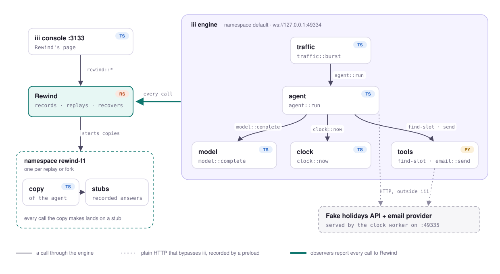

# Rewind

Rewind records every call between the functions of an iii app, so you can replay a request that
failed, change one answer and see what happens, and finish work that a crashed worker left behind.
The app's code doesn't change: every call already goes through the iii engine, and Rewind watches
from a worker of its own.

It ships with a small scheduling agent to debug, an agent in TypeScript with tools in Python, which
has three bugs planted on purpose ([BUGS.md](BUGS.md)).

- Walkthrough video (4 min): [docs/media/rewind-walkthrough.mp4](docs/media/rewind-walkthrough.mp4)
- Short promo (68 s): [docs/media/rewind-promo.mp4](docs/media/rewind-promo.mp4)

## Start it

You need iii 0.26.0 (`iii update`), Node 20 or newer, `uv` (it fetches Python 3.11 for the tools),
and a Rust toolchain. Then:

```bash
iii compose --up
```

That's the one command. It checks the machine first and stops with a list of anything missing,
then installs every worker's dependencies, builds Rewind, and starts the engine with nine workers.
The first start compiles Rewind, which takes a few minutes; later starts take seconds.

Open http://127.0.0.1:3133 and choose **Rewind** in the navigation. To give it something to show,
send the agent 40 requests:

```bash
npm run traffic
```

That runs `iii call --engine ws://127.0.0.1:49334 traffic::burst --json '{"count":40}'`. Stop
everything with `npm run stop`, which runs `iii kill --compose worker-compose.yaml`.

## What's running

<picture>
  <source media="(prefers-color-scheme: dark)" srcset="docs/media/topology-dark.svg">
  
</picture>

Every solid arrow is a call that goes through the engine, which is how Rewind sees it without the
app knowing. The dotted arrows are plain HTTP that bypasses iii; a preload in each worker records
those. A replay runs a copy of the agent in a namespace of its own, so every call it makes reaches
one of Rewind's stubs instead of the workers above.

## Try it in five minutes

1. **Find a failure.** Rewind groups the runs by how they failed. Open one that threw
   `SyntaxError`: the model cut off its tool arguments (bug 1).
2. **Replay it.** The replay fails the same way every time, because every call gets the answer it
   got the first time. Asking the model again would give a different answer.
3. **Fork it.** Fix the cut-off answer and fork. The agent runs again with your answer, books the
   meeting, and `email::send` gets a reply recorded in another run. No email goes out, because
   `email::send` declares itself irreversible.
4. **Kill a worker mid-flow (the failure demo).** Run `npm run traffic` again, and while it runs,
   kill the Python tools worker from a second terminal:

   ```bash
   npm run kill-tools
   ```

   The engine fails each call the tools were running with `invocation_stopped`, and new calls fail
   with `function_not_found` until compose restarts the worker about a second later. Nothing
   retries those calls, so the agent's runs fail, and the model answers that led up to them would
   be lost if Rewind hadn't recorded them. The runs show up under **Interrupted**, each with the
   call that was cut off and the worker disconnecting and reconnecting in the middle of it.
   [DESIGN.md](DESIGN.md#what-happens-to-in-flight-work-when-a-worker-stops) has what iii does in
   that moment, measured.

   **Recover all** replays the calls that finished, runs read-only calls live, and asks you before
   anything that writes or can't be undone. A send that was cut off mid-call may already have
   reached the email provider, so Rewind asks whether to mark it sent or send it again.
5. **Kill Rewind itself.** Leave one recovery waiting for an answer, run `npm run traffic`, and
   kill Rewind while the requests are running:

   ```bash
   npm run kill-rewind
   ```

   The requests all finish, and compose restarts Rewind within seconds. Runs from while it was
   down are missing, and the recovery you left is still waiting.
   [DESIGN.md](DESIGN.md#when-rewind-itself-stops) has the one case where this could send an
   email twice.

## Why it's built on iii

Rewind works because of three things iii already has: one engine that every call goes through,
observers that report each call's input, result and caller, and namespaces that decide where a call
goes. A replay is a copy of the agent running in a namespace of its own, where every call it makes
reaches a stub that returns the recorded answer. Each function's declared effects (read-only,
irreversible and so on) decide what a fork may run against the live system.

[DESIGN.md](DESIGN.md) covers why iii and where it falls short compared with Kafka, Temporal, and
queues with Lambdas, how iii could scale and federate, and what Rewind had to work around.

## Beyond the core

The four steps above are the core. I kept going to understand where iii stops helping, and each
addition ran into a specific gap, which DESIGN.md describes:

- **Calls around iii.** A preload records HTTP requests that never go through iii, such as the
  agent's holiday lookup and the tools' email POST, and replays them too.
- **Checking a fix.** When the agent's code changes, Rewind replays every recorded crash against it.
  With the fix in `docs/demo-fix.patch`, the check also turns up bug 2.
- **Copies of several workers.** A replay can run the tools' Python as well as the agent, and can
  start from any recorded call, not only an agent run.
- **A player, Traces sync, saved tests, and parallel recovery** with copies kept ready.
- **Two engines.** The tools moved to a second engine behind iii's bridge
  ([docs/multi-engine.md](docs/multi-engine.md)).

## Check it

With the stack running:

```bash
npm run check
```

That's the end-to-end check: 74 checks across recording, replay, forks, the calls around iii,
checking a fix, and recovering after a worker is killed. Unit tests for the Rust core, the preloads
and the page, and what each check covers, are in [docs/testing.md](docs/testing.md).

## Where things are

| Path | What it is |
| --- | --- |
| `workers/agent` | `agent::run`, the scheduling agent (TypeScript) |
| `workers/model` | `model::complete`, a fake model seeded from `MODEL_SEED` (TypeScript) |
| `workers/clock` | `clock::now`, plus the fake holidays API and email provider (TypeScript) |
| `workers/tools` | `calendar::find-slot` and `email::send` (Python) |
| `workers/traffic` | `traffic::burst`, which sends the agent requests (TypeScript) |
| `workers/journal` | The journal that makes `agent::run` durable, the recovery that starts an interrupted run again, and the waits and sleeps a run can pause on (TypeScript) |
| `workers/rewind` | Rewind itself (Rust), with its page for iii's console (TypeScript) |
| `workers/rewind/preload` | The preloads that record calls around iii (Node and Python) |
| `docs/rewind.md` | How Rewind works, and every function its page calls |
| `docs/flows/` | Each flow step by step with a diagram: record, replay, fork, check, recover, resume, pause, save as test |
| `docs/spike.md` | What iii 0.25.0 does, measured before building |
| `docs/spike-0.26.md` | What iii 0.26.0's observers change for Rewind, measured |
| `docs/multi-engine.md` | What still works when the tools run on a second engine |
| `docs/durable-execution.md` | How an agent run survives the agent dying mid-run, measured with `npm run kill-agent`, and how a run pauses for an approval with no worker held |
