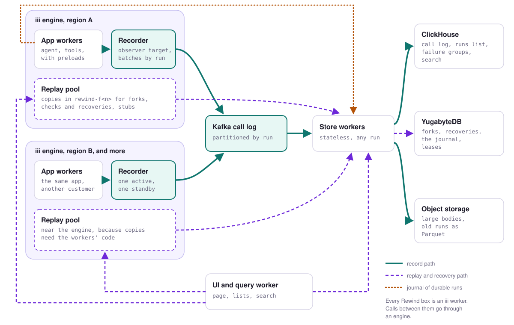

# Durable and horizontally scaled Rewind

## The architecture

At scale, Rewind is five kinds of iii worker. Every engine gets a recorder and a replay pool, and
all engines share a set of store workers and one UI and query worker. A completed call goes from the
engine to its recorder as an observer event, from the recorder to a Kafka log keyed by run, and from
the log through a store worker into ClickHouse, with large bodies in object storage. A replay, a
fork or a recovery starts in the UI, runs in the replay pool of the engine where the run happened,
and reads the recording and saves forks and recoveries in YugabyteDB through the store workers.
Durable runs keep their journal in YugabyteDB too. The app workers' preloads write each step of a
durable run through the store workers, and a run that a crash cut short starts again on the app's
own workers.

<picture>
  <source media="(prefers-color-scheme: dark)" srcset="media/durable-scale-dark.svg">
  
</picture>

Calls between Rewind's own workers go through an engine like any other iii call. Two paths leave
iii on purpose: the recorder writes to Kafka with a Kafka client, and store workers reach their
databases with database clients. That keeps the bulk of the record path from adding engine traffic,
and it means a slow database can never back up into the engine's observer queues.

On one machine the same workers run on one engine. The store worker launches Postgres as a child
process, the recorder calls the store worker's append function instead of writing to Kafka, and
there is no ClickHouse or object storage. That form is described near the end, under "Running on
one engine".

Every component Rewind adds is open source. iii's SDKs are Apache 2.0, while its engine and CLI are under
the Elastic License 2.0, which is source-available. Kafka, ClickHouse, YugabyteDB and Cassandra are
Apache 2.0, Citus is AGPL, Postgres has its own permissive license, and the S3-compatible stores
named below are Apache 2.0 or AGPL.

## The layers

### iii engine

The engine routes every call between the app's workers and delivers observer events. There is one
per customer or region, and Rewind adds a recorder and a replay pool to each. Rewind owns nothing in
the engine except its observers, which live in the engine's memory and are replayed by the recorder
when it reconnects. When load grows you add engines, and Rewind's per-engine workers come with
them. When an engine dies, its in-flight calls and any observer events it had not delivered are
gone, and workers reconnect when it comes back.

### App workers

These are the app's own workers, unchanged except for Rewind's preload in Node and Python workers.
The preload records HTTP that goes around iii. In a Node worker it also keeps the journal of each
function that declares `durable: true`: it saves each call's intent before the call goes out and
its result before the code sees it, and when the run starts again after a crash it hands the code
the saved results ("Resuming after a worker crash", below). When an app worker dies, the engine
fails its in-flight calls with `invocation_stopped`, and the observers of those calls get nothing.
For a durable run, the journal's intents say which call was cut off. For any other run, Rewind
finds it from the run's error, as it does today.

### Recorder

The recorder is the observer target for every recorded function on its engine, the same observers
Rewind makes today, capturing `input`, `output`, `error`, `caller` and `metadata`. Its handler adds
the trace id from the activation, appends the envelope to an in-memory batch and returns at once.
Every 50 ms, or once a few hundred events are waiting, it sends the batch to Kafka keyed by run. It
also forwards the preload's captures of requests around iii for workers on its host, and a small
shipper worker does the same on other hosts.

It owns nothing durable. You do not add recorders to one engine for load, because every observer
delivers every event to its target, so two recorders observing the same functions store each call
twice. One recorder is active and a second waits; when `engine::on-workers-changed` says the active
one disconnected, the standby registers its observers. If one recorder process can't keep up, the
functions are split between recorders, each observing its own share. When a recorder dies, events
for its engine are dropped until the standby's observers are active, plus whatever was in its
unsent batch. Observer delivery is at most once in any case.

### Kafka call log

Kafka (Apache 2.0, in KRaft mode) is the durable buffer between recorders and store workers. The
topic is keyed by run, so all of a run's events land in one partition in the order they were sent.
It keeps the last day of everything recorded, bodies included. When load grows you add partitions
and brokers. When a broker dies, its partitions fail over to replicas. When the whole cluster is
unreachable, recorders keep batches in memory up to a cap and then drop them with a counter; the
engine never waits on Kafka, because the recorder's handler returns before anything is sent.

### Store workers

Store workers are stateless iii workers. Each is a member of one Kafka consumer group, so Kafka
assigns it a set of partitions. For each run it reads, it puts the observer events and the
preload's captures together, decides which bodies to keep (see "Tail-based sampling"), writes calls
and the run's summary row to ClickHouse in large inserts, and writes bodies over 64 KiB to object
storage. Store workers also register the `rewind-store::*` functions that the replay pools and the
UI call: a run's calls, the runs list, search, failure groups, and reading and writing forks and
leases. They serve the journal's functions as well, `journal::begin`, `journal::intent`,
`journal::result` and the rest, over YugabyteDB, so durable runs on every engine share one
journal.

They own no data. When load grows you add instances; Kafka moves partitions to them, and any
instance can serve any query because the databases find the right shard themselves. When one dies,
Kafka gives its partitions to the others, which start from the last committed offset. Writes are
keyed by engine and invocation id, so a batch written twice leaves one row per call.

### ClickHouse

ClickHouse (Apache 2.0) stores the call log: one row per recorded call, with ids, function, status,
timings, caller, trace, code version and bodies under 64 KiB. A runs table, built from the log as
runs arrive, has one row per run with its status and a failure signature, which is what the runs
list, failure groups and search read. Its sort key starts with engine and run id, so reading one run
for a replay is a short range scan. When load grows you add shards, sharded by run id, and replicas.
When it is down, store workers stop committing Kafka offsets and the backlog waits in Kafka, while
lists in the UI go stale and new replays wait for it to return.

### YugabyteDB

YugabyteDB (Apache 2.0) stores the small transactional state: forks with their answers, settings and
outcome; recoveries; fork leases; the journal of durable runs, with their steps, pending steps,
deadlines and the values their waits got; and per-engine settings such as record toggles, code
versions and fork number counters. A fork's rows change a few times per fork action, and a durable
run writes twice per step. Both need transactions and compare-and-set: the journal fences every
write by the run's epoch in the same transaction that saves it. Tables are hash-sharded by run id
or workflow id, and the database routes each query to its shard by itself. Its SQL layer reuses
Postgres's query layer, so the schema from the one-engine Postgres store keeps working. When load
grows you add nodes and tablets split. When it is down, forks and recoveries stop because they
can't save, durable runs wait up to 30 seconds per write and then stop until it is back, and
recording goes on.

A durable step waits for its write, so the journal's latency adds to every step. On today's SQLite
journal that is about 2.7 ms per step, and on a distributed store it is unmeasured.

### Object storage

S3, or an S3-compatible server such as SeaweedFS (Apache 2.0) or MinIO (AGPL), stores bodies over
64 KiB, each under its SHA-256, so a prompt repeated across runs is stored once. It also stores runs
older than the hot window, moved out of ClickHouse as Parquet files per engine per day, which
ClickHouse's `s3` table function or DuckDB reads when someone opens an old run. Nothing needs adding
as load grows. When it is down, large bodies and old runs can't be opened, and everything recent
under 64 KiB still works.

### Replay pool

Each engine has one or more replay workers, which run forks, checks and recoveries the way Rewind
does today: copies of workers in `rewind-f<n>` namespaces, stubs that return recorded answers, and
live calls where effects allow them. The pool runs next to its engine for two reasons: a copy has to
connect to the engine where its namespace is, and starting a copy needs the worker's code from the
compose file. A replay worker takes a lease on a fork before it reruns it. A live call it makes
goes out with an idempotency key when its function takes one, `rewind:<run id>:<place>:<hash of
the input>` as Rewind sends today, so a function such as `email::send` drops the same send made
again after a crash. When load grows you add replay workers and spares. When one dies, its copies
stop by themselves as they do today, its leases expire, and another replay worker picks the fork
up from its saved answers. A live call to a function that takes no key can still go out twice, when
a replay worker dies between the call and saving the fork.

### UI and query worker

This worker serves Rewind's page in the console and registers the `rewind::*` functions the page
calls. Lists, search and failure groups come from ClickHouse through the store workers. Fork,
answer and recover go to the replay pool of the run's engine. It also sends `rewind::changed` to
open pages, from events the store workers send after they commit. It is stateless, so you add
instances when load grows, and when it dies only the page stops.

## Decisions

### Keep the call log and the transactional state in different stores

The call log is append-only, large and read in bulk: one run at a time for a replay, or millions
of runs at a time for failure groups and search. Fork state and the journal are small and need
transactions: a lease must be taken before a rerun, and a durable run's step must be saved, fenced
by the run's epoch, before the run's code goes on. One store does one of these badly. ClickHouse
has no row transactions, and it updates rows with asynchronous mutations. A single Postgres primary
handles the state comfortably, but at 16,000 recorded calls per second per engine, the rate one
engine recorded on a busy laptop (about 1.5 KB each in SQLite, 24 MB/s), a hundred engines would
put 2.4 GB/s of appends on it.

Analytic reads also get in the way of the write path when they share a store. Rewind's binary used
to keep one connection behind one lock for the writer thread and every page query, so a slow runs
list made the writer wait while calls kept arriving. Each query now takes a read connection of its
own, and with WAL it reads the last commit without the writer's lock.

### Kafka between recorders and store workers

The log has three jobs. It keeps each run's calls in order. It lets a store worker read again from
an offset after a failed write, or fill a new store from history. And it spreads partitions across
store workers with no coordination code in Rewind.

The measurements show why the log has to be there. The engine's observer queue is the first thing
to fill: each observer allows 64 activations in flight and queues 1,024 more, and past that the
engine drops events as `OVERFLOW`. On the busy laptop the bench ran on, Rewind lost 34% of calls
this way at 24,000 calls per second, and 40% at 16,000 in a run where the machine was busier still.
Anything that slows the recorder's
connection makes it drop sooner: the batch recorder, which sends its batches through the engine on
the same connection that receives activations, dropped 6% at 16,000 calls per second, where the
no-op target dropped none. So the recorder hands each batch to a log on a connection of its own,
and a database outage turns into Kafka lag instead of lost calls.

The alternatives:

- **Classic RabbitMQ queues** delete a message once it is acknowledged, so nothing can read it
  again, and several consumers sharing a queue lose per-run order.
- **RabbitMQ Streams** (with super streams for partitioning, MPL 2.0) and **NATS JetStream**
  (Apache 2.0) both do all three jobs. NATS is a single binary and much lighter to run than Kafka,
  which makes it the main rival.
- **Redis Streams** keep data in memory, and durability depends on append-only file settings and
  asynchronous replication. Redis also left the BSD license in 2024; Valkey is the BSD fork.
- **Pulsar** (Apache 2.0) has the same model as Kafka with more moving parts: brokers plus
  BookKeeper plus a metadata store.
- **Redpanda** speaks Kafka's protocol, but its core is under the BSL, which bars offering it as a
  commercial streaming service until a release converts to Apache 2.0 after four years.

Kafka wins on its record at this volume and because partitions, offsets and consumer groups are its
core model. It loses on what it costs to run, with three brokers as the minimum. Its throughput for
Rewind's batches hasn't been measured; the next experiment is the batch recorder from
`experiments/scale` writing to Kafka and to NATS JetStream at the same rates.

### ClickHouse for the call log, over Cassandra

ClickHouse stores the log in columns, compresses repeated JSON well, and is fast at the cross-run
questions the UI asks: group the last week's failures by signature, find the runs whose input
mentions a customer id, list the newest failed runs of one function. With engine and run id leading
its sort key, reading one run is also fast. It is weak at updating single rows, which is why fork
state lives elsewhere and why today's `set_span_id` update becomes an insert into a small side
table.

Cassandra (Apache 2.0) partitioned by run takes writes at this rate and reads a run quickly, which
is why Temporal can use it for histories it only ever reads by workflow id. Rewind's UI also asks
questions across runs, and Cassandra can't group or search without a second system next to it.
ScyllaDB would be the faster Cassandra, but it has been source-available since late 2024; 6.2 was
its last AGPL release.

### YugabyteDB for state, with Postgres plus Citus as the fallback

The state is small. Forks are made by people, so even a busy deployment makes thousands a day, and a
single Postgres primary with a replica handles that. Distributed SQL is for two other needs: state
in several regions, and failover without an operator.

YugabyteDB meets both. Its SQL layer reuses Postgres's query layer, so the schema and queries from
the one-engine Postgres store keep working, and it shards by key and routes queries to the right
shard itself, which is what lets store workers stay stateless. Citus (AGPL) is plain Postgres with
a distribution column, which many teams already know how to run, but failover is per node with
standbys, and a coordinator node routes queries. Pick YugabyteDB when state spans regions, and
Citus when the team already runs Postgres and one region is enough.

The rest lost on a stated fact:

- **CockroachDB** has been under the single CockroachDB Software License since 2024-11-18, free only
  under $10M revenue, with telemetry required on the free tier.
- **TiDB** (Apache 2.0) speaks MySQL, and the one-engine path is Postgres.
- **FoundationDB** (Apache 2.0) is an ordered transactional key-value store with strong guarantees,
  but Rewind would have to build its own record layer on it to store a handful of tables.

### Tail-based sampling in the store workers

Every call's metadata is kept: function, status, timings, caller, sizes and a hash of each body.
Full bodies are kept for runs that failed, were interrupted, had a call the caller gave up on, or
touched an irreversible function. Successful runs keep their bodies at a sample rate, 5% to start,
plus a per-function set of recent successful outputs, which is what `auto` uses to fill a call.

The bench stores about 1.5 KB per call in SQLite, 1.06 KB of it input and output. At 16,000 calls
per second, the rate one engine recorded on the laptop, that is about 2 TB a day per engine before
compression, nearly all of it bodies of runs
nobody opens. Keeping metadata for every call and bodies for 5% of successful runs brings it to
roughly 200 bytes a call, about 280 GB a day per engine. Head sampling, deciding when a run starts,
can't know the run will fail. Keeping everything is the rival, and it costs that much storage.

The decision is made in the store worker because that is the first place that sees all of a run's
observer events and captures together, in one Kafka partition. A run counts as ended when its
root's event has arrived and no call has arrived for 300 ms, or 2 s after the root, the same rule
`settling.rs` uses today. A successful run whose bodies were sampled out can't be replayed, and the
UI has to say so before anyone clicks.

### Object storage for bodies over 64 KiB

64 KiB is where the preload already cuts bodies (`REWIND_MAX_BODY_BYTES`). Rows that big slow
ClickHouse's scans and run into Kafka's 1 MB default message size, and a prompt repeated across runs
would be stored once per run. Storing the body by its SHA-256 in object storage, with the hash in
the row, fixes all three. Keeping everything in ClickHouse lost on scan speed and storage price, and
cutting bodies like the preload does lost because a cut body can't be replayed live.

### Recorders batch, one store call per batch

The `batch` recorder in `experiments/scale` observes the same functions as Rewind and sends what
arrived to a store worker, `scale::append`, through the engine every 50 ms or 500 events, waiting
for each reply. At 12,000 calls per second it stored every call, sending one store call per 400 to
500 events and waiting about 9 ms for each. The engine used the same CPU as with the no-op target
(2.72 cores against 2.68), and the batching recorder used a quarter of a core more (1.16 against
0.89). At 16,000 calls per second it dropped 6% of calls, where the no-op target and Rewind dropped
none, because serializing a batch of a few hundred KB on the SDK connection delays the activations
behind it.

So the engine hop per batch costs nothing measurable at the engine up to 12,000 calls per second,
and it costs calls at 16,000 when it shares the recorder's connection. At scale the recorder writes
its batches to Kafka on a connection of its own. On one engine it calls the store worker's append
function through the engine with the same batch, idempotent by batch id, which held up below about
12,000 calls per second on the laptop. One store call per recorded call lost because it would
double the engine's message count for recording, and one observer already raises the engine's CPU
about 1.7 times (from 1.57 to 2.68 cores at 12,000 calls per second).

### Sharding without routing by key

iii routes a call by function id and namespace. It has no way to send the calls for run X to the
instance that owns run X. So the design never needs it: store workers are stateless, and each
database routes by key itself (Kafka by partition key, ClickHouse by sharding key, YugabyteDB by
hashed primary key). Any store worker can serve any run, whether the engine spreads calls to one
function id across several workers or keeps one owner with the rest waiting. iii 0.25 refused a
second owner of a function id in one namespace with `FUNCTION_NAMESPACE_CONFLICT` (spike, question
2), and the design works either way.

Where affinity matters, the owner registers a function id of its own. A paused fork keeps its
copies open on one replay worker, so that worker registers `rewind-replay::answer-<engine>-<n>`
and writes the id into the fork's lease row, and the UI calls that id. If the worker is gone, the
UI calls the pool's shared id and another worker opens the fork cold, which takes a few seconds.

The rival was per-shard function ids in front of local shards, such as `rewind-store-07::append`
owning one SQLite file. It works with iii as it is, but every caller needs the shard map,
resharding renames functions, and a dead shard worker makes its runs unreadable. The measurements
say one store per engine is enough on the one-engine path, so it isn't needed there either.

### How Rewind keeps from recording its own calls

Today the recorder observes only functions on its record list. Rewind's own `rewind::*` functions,
functions with `metadata.internal`, and functions in other namespaces are never on it, and an
envelope whose caller worker is `rewind` or Rewind's stub worker is dropped (`made_by_rewind`),
which covers the live calls a fork makes in `default`.

The scaled design keeps both rules. Every Rewind function id starts with `rewind`
(`rewind::`, `rewind-store::`, `rewind-replay::`) and declares `metadata.internal`, and every
Rewind worker connects with a name from a fixed set. The journal's functions are internal as well,
so the steps a durable run writes are never recorded. The rule matters for the store call: the
recorder sends its batches from a background task, outside the observer handler, so the engine's
`LOOP_GUARD`, which counts observer depth, would never see a loop if `rewind-store::append` were
recorded. Each append would be recorded and appended again. At scale the batch goes to Kafka and
is not an iii call at all.

The weakness is that a worker picks its own name, so an app worker named `rewind` would hide its
calls from Rewind.

## How a call moves through it

### Recording one call

`agent::run` on engine A calls `calendar::find-slot`. `agent::run` is durable, so the agent's
preload first saves the step's intent with `journal::intent`, which a store worker writes to
YugabyteDB, and waits for it. The engine routes the call to the tools worker. When it completes,
the preload saves the step's result with `journal::result` before the agent's code sees it. The
engine also matches the recorder's observer and delivers the envelope (input, output, error,
caller, metadata) to the recorder, whose handler adds the trace id, appends the envelope to its
batch, and returns. The two writes are independent of each other: the journal has what a durable
run needs to start again, and the recording has what Rewind needs to replay any run.

Within 50 ms the batch goes to Kafka, keyed by the run's trace id. The envelope says which call
made this one but not which run it belongs to, and a child completes before its parent, so the
recorder can't find the run by walking callers as events arrive. Each run that starts outside a
span is the root of its own trace, as `traffic::burst` arranges, so the trace id groups a run's
calls. A call that arrives with no trace context is keyed by its caller's invocation id instead.
The preload writes the same trace id into each capture of a request around iii, so those captures
land in the same partition.

A store worker reads the partition, places each call under its caller, waits for the run to
settle, applies the sampling rule, writes the calls and the run's row to ClickHouse and any large
body to object storage, and commits the offset. It then sends `rewind::changed` to the UI and query
worker, and the run appears in open pages.

### Replaying or forking

Someone clicks Replay. The UI and query worker looks up the run's engine and calls the replay pool
on that engine. A replay worker takes a lease on the new fork in YugabyteDB, reads the run's calls
through `rewind-store::run`, takes a spare copy of the agent in `rewind-f<n>`, and calls
`agent::run` there with the recorded input. Each call the copy makes reaches a stub, which returns
the recorded answer.

When a fork needs a live call, the replay worker makes it in `default`, with an idempotency key
when the function takes one. When the rerun ends, it saves the fork with its answers and its
outcome, releases the lease, and the page updates.

### Resuming after a worker crash

Two kinds of crash need different answers, and on one engine both are handled today.

When the agent dies in the middle of a durable `agent::run`, the run's own worker is gone. The
engine fails the call with `invocation_stopped` and never reports the run to observers, so Rewind
has no root for it and can't recover it. The journal starts it again instead. It hears the worker
disconnect from `engine::on-workers-changed`, clears that worker as the owner of its running runs,
waits until `agent::run` is registered again, and calls it with the same `_workflow_id`. The
preload in the restarted agent gets the saved steps from `journal::begin`, and each step with a
saved result returns it without a call. The step that was in flight goes out again when its
function's effects say a repeat is harmless, goes out again with its original idempotency key when
it is irreversible and takes one, and otherwise stays pending until a person resolves it. A run
that calls `durable::wait` or `durable::sleep` waits the same way, as a pending step with nobody
running it, and starts again once the step is resolved or its time comes.
[durable-execution.md](durable-execution.md) has the decisions behind this and what the bursts
measured, and [resume.md](flows/resume.md) and [pause.md](flows/pause.md) go through it step by
step.

At scale the journal works the same way, and only its tables move. Steps, pending steps, deadlines
and wait values live in YugabyteDB behind the store workers, keyed by workflow id, so a run can
start again on any engine that hosts its function. The sweep that calls a run again needs one
engine's worker changes and calls the function on that engine, so it runs next to each engine, the
way the recorder does.

When a callee's worker dies, such as the tools in the middle of `email::send`, the run itself goes
on. The engine fails the call with `invocation_stopped`, the observer of `email::send` gets
nothing, and the agent passes the error to the model and finishes as failed. A durable run saves
that error as the step's result, so the journal has nothing to resume. Rewind finds the run from
its error and lists it under Interrupted, and its recovery runs a copy in the replay pool:
completed calls get their recorded answers, read-only and external calls run live, and
`email::send` was cut off mid-call and is irreversible, so the recovery pauses with reason `lost`
and asks a person whether it went out. [recover.md](flows/recover.md) has the steps. A person
starts these recoveries from the page today. `engine::on-workers-changed` says when the tools come
back, so the replay pool could start them then, with a lease so two replay workers never recover
one run.

A recovery that finishes has nowhere to send its result, because the original caller already got
its failure. It could deliver the result to a place the app chose, such as a function named in the
entry function's metadata, but that is a contract to agree with the app, and iii has no place for
it.

### What iii provides for resume, and the workaround

Here is what 0.26 does, from iii's source and its specs in iii-hq/iii:

- A call ends as `success` or `error`, and `capture` decides which outcomes fire an observer. The
  default capture is `["input", "output", "caller"]`, which fires on success only. Rewind needs
  `["input", "output", "error", "caller", "metadata"]`.
- Nothing fires when a call starts. `on: start` is listed as optional, unshipped work in phase 6 of
  `tech-specs/2026-10-13-observe/README.md` in iii-hq/iii.
- An interrupted call is dropped on purpose. `tech-specs/2026-10-29-observe-v2/decisions.md` says a
  routed call whose observe.v2 host ends without answering activates nothing, and each observer
  counts a `CANCELLED` drop. The host's answer says which observers matched, so without it the
  engine can't tell whom to deliver to. (In 0.25 the spike saw the same drop counted as
  `INACTIVE`.)
- Delivery is at most once, and observers live in the engine's memory only.
- Since 0.26, a worker calling its own function runs it in process, and the SDK reports the call in
  batches, only when an observer matches.

The journal builds around this without an engine change:

- Rewind's Node preload wraps the worker the SDK returns, through a loader hook. For a function that
  declares `durable: true`, it wraps the handler and every call the handler makes.
- Each call the handler makes is a step, numbered in the order the code starts it. Before the call
  goes out, `journal::intent` saves the epoch, the step number, the function and a hash of the
  input, and returns an idempotency key when the callee is irreversible. After the call returns,
  `journal::result` saves its value or error, and only then does the code see it.
- The journal observes `engine::on-workers-changed`, so it knows at once when a run's worker left,
  and a sweep every second starts the runs that lost their owner again.
- Each start of a run takes the next epoch, and the journal refuses a write from an older one as
  `FENCED`, so a handler that lost its connection but kept running can't save anything once a newer
  execution has taken over.
- iii's queue is the other way to start a run again. Queue worker 0.22.2 keeps a job whose worker
  died and delivers it again once the function is registered again. Enqueue drops the call's
  metadata, so the workflow id goes in the payload as `_workflow_id`.

What this leaves uncovered:

- Only Node workers with the preload can run durable functions. Python, Rust and Go functions can
  still be steps, because the caller's preload makes them.
- A model call in flight at the crash is made twice, because the engine dropped its answer along
  with the dead caller.
- A crash of the engine itself loses every in-flight call and the observer events it had not
  delivered. The journal on disk is what would let durable runs go on, and that wasn't measured.
- The journal covers durable runs only, and Rewind's recording still has gaps. Observer drops under
  load (`OVERFLOW`) still happen. While the recorder is cut off from the engine, calls made in that
  window reach no observer, and iii doesn't count them as drops. The recorder's own handle keeps
  saying `active` while the engine has it `suspended`, so the recorder can't tell from its side
  either (`docs/spike-0.26.md`, probe d). The journal keeps only a hash of each step's input, so it
  can't fill those gaps.
- Rewind records each execution of a durable run as a run of its own, and can't replay a resumed
  run as one run yet.

### Three ways to finish an interrupted run

**Recover automatically when the worker reconnects.** iii provides the signal:
`engine::on-workers-changed` fires on connect and disconnect. The journal uses it for a durable run
whose own worker died, and calls the run again once its function is registered again. For a run
whose callee's worker died, Rewind could start the recovery the same way, with the same policy as
Recover all and a lease so two replay workers never recover one run, but a person still starts it
from the page. Nothing in the engine has to change. The open question is where the finished result
goes.

**Continue the run on the live workers in `default` instead of in a copy.** The journal does this
for durable runs, inside the preload: the wrapper sees each call before it goes out and returns the
saved result when the run starts again. That works only for preloaded Node workers, and only when
the function's code depends on nothing but its input and what its calls return, which is why a
function opts in with `durable: true`. iii's worker manager has `middleware_function_id`, a
function every invocation through an RBAC listener passes through, which could do the same for any
worker. But it would be in the path of every call the app makes, the engine turns local dispatch
off for those sessions, and it replaces the caller and the error codes (`docs/spike-0.26.md`).
Rewind's recovery of a run whose callee died stays in a copy, which needs neither condition.

**Record a call's start before it is dispatched.** iii fires nothing at start, and `on: start` is
optional, unshipped work in its plans. The journal's intent is that record for each step of a
durable run. For the live calls Rewind makes itself in forks and recoveries, the idempotency key
covers the window where a restarted Rewind sends `email::send` a second time: a fork saves only
when a rerun ends, and the repeat goes out with the same key, so `email::send` returns the first
send's reply. A function that takes no key would still send twice.

### Compared with Temporal and Restate

Temporal journals a workflow's history in its database (Cassandra, MySQL or Postgres, sharded by
workflow id). When workflow code calls an activity, the workflow task completes with a command,
and the server appends `ActivityTaskScheduled` to the history, in the same database transaction as
the internal task that will dispatch it, before any worker runs it. The result is appended as
`ActivityTaskCompleted`. If a worker dies mid-activity, a timeout fires and the activity is
retried, so activities run at least once, and the activity has to make its side effect idempotent,
usually with a key built from the workflow and activity ids. A crashed workflow worker is replaced by one that replays the history
through the same code, and calls whose results are in the history are not made again.

Restate puts its server in the call path. Each invocation has a journal, written to Restate's
replicated log and partitioned by key: the input, each `ctx.run` result, each call to another
handler, timers and state. A `ctx.run` block runs, and its result is journaled before the handler
goes on; if the process dies inside the block, the block runs again. A call to another handler is
journaled before it is sent and is deduplicated by invocation id, so calls between handlers happen
exactly once. On a crash, Restate invokes the handler again with the journal, and the SDK returns
journaled results instead of running those steps.

Both record the intent before the work is dispatched, because their server dispatches it. iii's
engine also dispatches every call, but it journals nothing: observers fire after completion, at
most once, from memory. The journal gets the same order from inside the calling worker: the preload
saves a step's intent before the call goes out and its result before the code sees it, the way
Restate journals a `ctx.run` block. Like Temporal and Restate, it still needs the callee to drop a
repeated key for a send to happen once, which `email::send` does.

## Measurements

One engine on a laptop busy with other work recorded 16,000 calls per second with nothing lost,
both with an observer target that only counts and with Rewind writing to SQLite, and neither kept
up at 24,000. A later run on a busier machine lost half the calls at 16,000 before they reached
Rewind, so 16,000 is what one engine managed on that laptop, and the engine's own limit is still
unmeasured. The design multiplies that rate by the number of engines, so the totals below carry the
same caveat. What the bench did measure well is the cost of observing: one observer roughly
doubles the engine's CPU per call.

The bench is in `experiments/scale`. It starts an engine on port 49534 with no other workers, four
lanes of a small Node app, and one recorder. The runs in the table used iii 0.25.0. The bench has
since moved to 0.26, and `rewind-bounded.json`, below, is its one run there. In each lane,
`scale::run-<n>` calls `scale::echo-<n>` nine times in a row from another process, so every call
goes through the engine and a run has ten recorded calls, close to an agent run. Each input has a
512-byte pad, which the echo returns, so Rewind stores about 1.5 KB per call. Loaders send runs
open loop at a fixed rate for 10 seconds per step. The recorders are:

- `none`: nothing observes, which is what the app and engine alone can do.
- `noop`: a Rust target with the same observers as Rewind that only counts. This is the ceiling.
- `rewind`: Rewind's release binary from this tree with its SQLite writer. This is the rival.
- `batch`: a Rust target that sends envelopes to a store worker through the engine, one call per
  50 ms or 500 events.

The machine is an M2 Max with 12 cores, shared with other work. The table is from one back-to-back
run of `noop`, `rewind` and `batch` while the load average was 10 to 17. The `none` column is from an
earlier pass while it was 14 to 23; at 24,000 that run was itself saturated, with a 99th percentile
run time of 7.3 s, so its engine figure is low. No run was on an idle machine, so every point where
a recorder starts to drop is where this laptop stopped, under that load. CPU is in cores, so 2.68
means 268% of one core.

| Calls per second | Engine CPU, nothing observing | No-op: stored, engine and target CPU | Rewind: stored, engine and Rewind CPU | Rewind: writer behind by, caught up after | Batch: stored |
| --- | --- | --- | --- | --- | --- |
| 6,000 | 0.72 | 100%, 1.49 and 0.49 | 100%, 1.68 and 1.08 | 24 calls, 8 ms | 100% |
| 8,000 | 1.21 | 100%, 1.91 and 0.62 | 100%, 2.10 and 1.36 | 210 calls, 13 ms | 100% |
| 12,000 | 1.57 | 100%, 2.68 and 0.89 | 100%, 2.84 and 1.70 | 2,069 calls, 148 ms | 100% |
| 16,000 | 1.75 | 100%, 3.20 and 1.11 | 100%, 3.21 and 1.90 | 55,611 calls, 3.2 s | 94.3% |
| 24,000 | 1.13 | 80.7%, 3.80 and 1.25 | 65.5%, 3.56 and 1.76 | 67,610 calls, 4.4 s | 61.4% |

At 24,000 calls per second the app still made 23,980 calls a second, and every recorder lost calls
as `OVERFLOW` drops in the engine: 19% for the no-op target, 34% for Rewind, 39% for the batch
recorder. Raising the no-op target's `max_in_flight` from the default 64 to 512 didn't help (72.4%
stored), so the in-flight window isn't what stopped it. The bench can't say what did. With nothing
observing at 24,000, runs slowed to a median of 5.6 s and a 99th percentile of 7.3 s while the
engine used about 1.1 cores, less than it used at 16,000. Something besides the engine was the
limit in that run, the load generator or the machine itself, so no run ever had the engine as its
only limit.

One observer roughly doubles the engine's CPU per call, and the ratio came out close at both rates
where it could be measured. At 12,000 calls per second the engine used 1.57 cores with nothing
observing and 2.68 with the no-op observer, 1.7 times as much, and at 16,000 it used 1.75 and 3.20,
1.8 times.

Rewind's writer cost about one more core than the no-op target, 1.70 against 0.89 at 12,000 calls
per second. At 16,000 it fell 55,611 calls behind during the 10 seconds and caught up 3.2 seconds
after the load stopped. Nothing was lost, because the record handler only put the call on a
channel, but the channel had no bound and Rewind's memory grew to 328 MB.

That run led to two changes in the writer. It now checkpoints the WAL every 10,000 pages, about
40 MB, with a 16 MB page cache. At SQLite's default of 1,000 pages, a sample during the 16,000 step
found half of the writer's busy time in checkpoints, most of it in fsync. And up to 20,000 calls
wait for the writer: past that, `rewind::record` drops a call and counts it, and `rewind::status`
reports the count. Writing 300,000 bench-shaped calls in batches of 500, offline with no engine,
the writer stored about 20,000 calls a second with the old settings and 37,000 with the new ones.
With no checkpoint at all it stored 46,000, which is the most a checkpoint setting could give. So
on this laptop the writer's ceiling is about 37,000 calls a second, above anything the engine
delivered to it in the bench.

The bench ran once more with the bounded writer, on iii 0.26 (`rewind-bounded.json`). Rewind
dropped no calls itself: its queue peaked at 5,609 calls and drained in 24 ms. The engine dropped
1.2% of calls at 12,000 and 50% at 16,000 as `OVERFLOW` before they reached Rewind, while it got
1.4 to 1.9 cores against 2.8 to 3.2 in the table. The five-minute load average was about 30 from
other work, and the engine was 0.26 where the table's was 0.25, so that run doesn't compare with
the table. Single steps at 16,000 run back to back stored 57% and 35% with the writer from before
the change, and 40% and 33% with the final build, so those drops followed the machine's load
whichever writer ran.

A busy machine lowers the ceiling. In the first pass, with the load average at 31 to 38 from other
work, the no-op and batch recorders started dropping at 8,000 calls per second (4.2% and 1.3%), and
Rewind, run when the load was 15 to 27, dropped 40% at 16,000. Drops come from activations waiting
longer to be scheduled, so a recorder on a crowded host drops sooner.

The engine hop per batch is cheap until the connection is busy: no measurable engine cost at 12,000
calls per second, and 6% of calls lost at 16,000 (see the batching decision).

The design multiplies the per-engine number by engines. Each engine has its own observers and its
own recorder, so recording capacity grows with the number of engines, and Kafka partitions,
ClickHouse shards and store workers grow behind them. A hundred engines at 16,000 calls per second
is 1.6 million calls per second, about 2.4 GB/s into Kafka before sampling and about 320 MB/s into
ClickHouse after it. 16,000 is the busy laptop's rate, so those totals move with whatever one
engine turns out to record on a host of its own. Kafka and ClickHouse at those rates are unmeasured
here.

One more thing turned up. Rewind hashes every file under `REWIND_TARGET_DIR` every second to track
the code version. With its own database inside that folder, Rewind died with `SIGBUS` inside
SQLite's WAL index read, twice in two tries. Rewind now leaves its own files out of the hash
wherever that folder points, and `docs/rewind.md` has why hashing them crashed it. The bench still
points the folder at `experiments/scale/src`.

To run it, build `workers/rewind` and `experiments/scale/noop` with `cargo build --release`, run
`npm install` in `experiments/scale`, then `npx tsx src/bench.ts <recorder>` from there. `III_BIN`
has to be an iii 0.26 engine, since the lanes and Rewind use the 0.26 SDK. Each run writes
`results/<label>.json`. The committed results are `none.json`, `noop.json`, `batch.json` and
`rewind.json` from the first pass, the `-rerun` files and `noop-inflight512.json` from the
back-to-back run, all on 0.25, and `rewind-bounded.json` on 0.26.

## What bounds it

The engine bounds everything on it. One engine dispatches every call and delivers every observer
event, and in the bench on the busy laptop it used 3.2 to 3.8 cores at 16,000 to 24,000 calls per
second while observers were attached. Recording can never go faster than the engine delivers
events, and the engine stops delivering in a known way: each observer has 64 activations in flight
and 1,024 queued (`observers.default_max_in_flight` and `observers.max_queue_per_observer`), all
queues together are capped at 64 MiB of observed calls, and past that new events are dropped as
`OVERFLOW`. Delivery is at most once and lives in memory, so an engine crash loses whatever was
queued.

The recorder is one process per engine, because each observer delivers to one target. Its share of
the work is small: the no-op target used 1.11 cores at 16,000 calls per second, and Rewind 1.90.
Rewind's SQLite writer stores about 37,000 calls a second on its own, offline on the same laptop,
so on one engine the engine's delivery runs out before the writer does. If the recorder ever
becomes the limit, the functions are split between two recorders, each with its own observers.

The rest of the design scales out behind the recorder: Kafka by partitions, store workers by
instances, ClickHouse by shards, YugabyteDB by tablets. None of it can make one engine record more
than the engine delivers. Adding engines is the way to record more.

If iii split into a control plane and many data-plane routers, the limit would move from engines to
routers. The control plane would keep the registry and the list of observers and push them to
routers, and each router would dispatch a share of calls and deliver the observer events for its own
calls, so a recorder would attach to each router or group of routers. One run's calls could then
pass through several routers and reach different recorders. The Kafka key, the run's trace id,
already brings them back to one partition, and store workers already order calls by
`started_at_ms`, because arrival order was never reliable. The recording rate would grow with
routers, and nothing in the store layers would change.

## Store options in full

Each row says which of Rewind's data a store fits. "Call log" is one row per recorded call, appended
and read by run. "Fork state" is forks, recoveries, leases and the journal of durable runs. "Runs
list and failure groups" are the queries across runs.

| Store | License | Call log | Fork state | Runs list and failure groups |
| --- | --- | --- | --- | --- |
| SQLite, one file | Public domain | One writer, about 37,000 calls a second offline on the laptop | Yes, on one machine | Yes, until scans get slow |
| SQLite per run or per shard | Public domain | Yes, but every caller needs the shard map | Yes | No: every cross-run query opens every file |
| Postgres | PostgreSQL | One primary: enough for one engine, not for many | Yes | Slow over months of calls |
| Postgres with Citus | AGPL | Yes, distributed by run | Yes | Better, with parallel queries across workers |
| YugabyteDB | Apache 2.0 | Possible, costly per row | Yes, chosen | Weak for analytics |
| TiDB | Apache 2.0 | Possible | Yes, but MySQL dialect | Has a column store add-on |
| CockroachDB | CockroachDB Software License | Possible | Yes | Weak for analytics; not open source |
| ClickHouse | Apache 2.0 | Yes, chosen | No row transactions | Yes, chosen |
| DuckDB | MIT | No: one writing process | No | Yes, over Parquet files |
| Cassandra | Apache 2.0 | Yes, partitioned by run | Lightweight transactions only | No ad hoc queries |
| ScyllaDB | Source-available since late 2024 | Yes | Same as Cassandra | Same as Cassandra |
| FoundationDB | Apache 2.0 | Needs a layer built on it | Yes, with a layer | Needs a layer |
| Kafka | Apache 2.0 | As the buffer in front, chosen | No | No |
| Redpanda | BSL core | As a buffer | No | No |
| NATS JetStream | Apache 2.0 | As the buffer, the main rival | No | No |
| Object storage with Parquet | Varies by server | Cold runs, chosen | No | Read by DuckDB or ClickHouse |

What partitions by run: the call log, captures and spans, forks, recoveries and leases, and the
journal, by workflow id. What doesn't: the runs list, which is ordered by time across all runs;
failure groups, which group across runs; code versions, which belong to a worker; record toggles
and worker changes, which belong to an engine; and fork number counters, which are per engine
because namespaces are.

## Running on one engine

Most deployments have one engine, and they need none of the clusters. The same workers run there:
a recorder, a store worker, a replay worker and the UI and query worker, with the journal worker as
it is today, on its own SQLite file. The store worker either keeps SQLite or launches Postgres as a
child process and stops it when it stops. The recorder calls `rewind-store::append` through the
engine once per batch instead of writing to Kafka. Sampling works the same way.

Today's single binary recorded 16,000 calls per second on a busy laptop without losing any, and its
writer stores about 37,000 a second on its own. The demo's `npm run traffic` sends a few dozen
calls a second. It already has most of the first step of the migration below. Each query takes a
read connection of its own, so a slow list never makes the writer wait. Up to 20,000 calls wait for
the writer, with a counter for what it drops, so a long burst can't grow memory without limit.
Rewind leaves its own files out of the folder it hashes for code versions. A live call goes out
with an idempotency key when its function takes one, and the journal starts a durable run again
when its worker comes back. Two things are left: starting the recoveries of runs whose callee died
when that worker reconnects, and saving a live answer as soon as it returns, for a function that
takes no key.

## Migration path

Each step works on its own and can ship before the next.

1. **Fix the single binary.** Queries have read connections of their own, the writer's queue is
   bounded with a drop counter, the capture has `metadata`, and a live call sends an idempotency
   key when its function takes one. What is left is to start recoveries when a callee's worker
   reconnects, and to save a live answer as soon as it returns. Risk: low. Saving earlier changes
   when a fork saves, which `scripts/e2e.ts` covers.
2. **A journal for durable runs.** Built for Node: the preload wraps a durable function's handler
   and its calls, and the journal worker keeps the steps in SQLite and starts a run again after its
   worker dies. What is left is the same wrapper in the Python preload, and Rewind reading the
   journal so a resumed run replays as one run. Risk: medium. The wrapper runs in every durable
   worker, and a bug there breaks the app, so `REWIND_DURABLE=off` turns it off.
3. **Split Rewind into workers on one engine.** Recorder, store worker, replay worker and UI worker,
   still on one SQLite file owned by the store worker, with batched appends. Risk: medium. More
   processes to start and supervise, and the engine hop per batch, which the batch bench measured.
4. **Store worker on Postgres.** The store worker launches Postgres locally and connects to a managed
   one in production, and the journal's tables move there with the rest of the state. Risk: medium.
   Data moves from SQLite once, and Postgres becomes something to operate.
5. **Kafka between recorder and store worker.** Risk: medium. New infrastructure, and writes must be
   idempotent because a store worker can read a batch twice.
6. **Call log to ClickHouse, state stays in Postgres.** Runs list, search and failure groups move to
   ClickHouse. Risk: high. Two stores that can briefly disagree, such as a fork that refers to a run
   ClickHouse hasn't shown yet.
7. **Sampling and object storage.** Risk: medium. A successful run someone wants later may have had
   its bodies dropped, so the sample rate needs a way to be raised per function.
8. **Many engines.** A recorder, a replay pool and the journal's sweep per engine, shared Kafka,
   ClickHouse and state, an engine id on every row, and Postgres to YugabyteDB or Citus once state
   spans regions. Risk: high.
   Runs that cross engines through the bridge, clock skew between engines, and the bridge dropping
   effects metadata (DESIGN.md, "Rewind across many engines").
