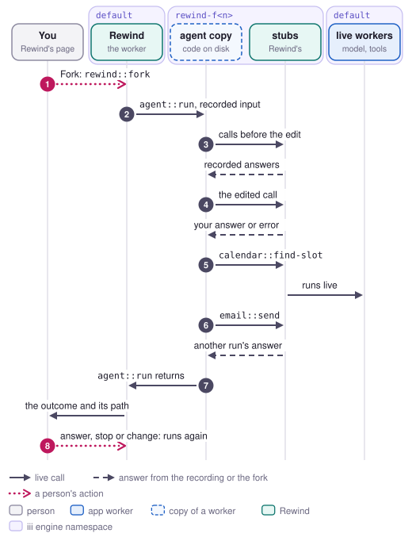

# Fork

A fork runs a recorded request again with one answer changed, or with an error put in place of an
answer, and lets the code run to its end. The developer reaches for it when they think they know
which answer caused a failure and want to see what the code does with a different one before they
write a fix (job 3 in [jobs.md](../jobs.md)).

<picture>
  <source media="(prefers-color-scheme: dark)" srcset="../media/flow-fork-dark.svg">
  
</picture>

## Steps

1. **A person** starts the fork from a call on the run.
   - To edit an answer, they click Edit answer. The editor shows the recorded answer as a form of
     the function's response schema, with the JSON one tab away and the recorded version kept for a
     diff. They change it and click Fork, which reads "Fork anyway" when the answer breaks the
     schema.
   - To inject an error, they choose Fork with error from the call's menu.

   Either way the page calls `rewind::fork` with
   `{ run_id, base, at_seq, answer, source, auto_read, auto: true, stops }`. `source` is `edited`
   with `answer: { value }`, or `injected` with
   `answer: { error: { code: "UNAVAILABLE", message: "injected by rewind" } }`. `base` is the fork
   the person was looking at, and is left out on the original run. `stops` are the run's stops,
   which the page keeps while it is open.
2. **Rewind** builds the fork's starting answers. With a base, it keeps the base's answers for
   every place before `at_seq`. It puts the new answer at `at_seq`, which has to be a call the run
   made itself in the base or the recording. Then it takes a namespace, registers the stubs and
   makes sure the copy runs the code on disk, the same as steps 2 and 3 of a
   [replay](replay.md), and calls `agent::run` in `rewind-f<n>` with the recorded input.
3. **The stubs** return the recorded answer for every call before the edit, the same way a replay
   does. With a base, the base's answers for those calls come first.
4. **The stub** at `at_seq` returns the edited answer, or throws the injected error, as long as the
   copy calls the same function there. The input the copy sends doesn't matter for the fork's own
   answers.
5. **The stubs** decide each new call, one the recording doesn't have at that place with that
   input, from the function's declared effects. A stop on the function comes first and pauses the
   fork with reason `stop`. With `auto` on, which is how the page forks, a call whose effects are
   all `pure`, `read-only` or `external`, and any GET or HEAD request, runs live in `default`. The
   fork marks it Live. In the diagram, `calendar::find-slot` runs live.
6. **The stubs** never run a call that writes, is irreversible, or declares no effects. With `auto`
   on, the stub returns the newest successful answer that function gave in another run of the same
   root function, marks the call Filled with `filled_from` set to that run, and nothing is sent. In
   the diagram, `email::send` gets another run's reply. When no other run has one, the fork pauses
   there with reason `no_answer`. With `auto` off, which is the default for other callers of
   `rewind::fork`, every new call pauses with `no_answer`, except a pure or read-only call when
   `auto_read` is on.
7. **The copy's `agent::run`** returns, throws or ends at the pause. Rewind stores the fork with its
   `parent`, `edit_at`, `auto` and `stops`, stops the copy in the background or keeps it for the
   next answer when the fork paused, and calls `rewind::changed`. The page lands on the outcome with
   a line that sums up the path, such as "Booked · 3 live · email::send filled from run 849b62e".
   It marks each call by where its answer came from, such as Recorded, Edited, Injected error, Live
   or Filled, and Compare lines the fork up against the original call by call.
8. **A person** can carry on from there, and each choice runs the fork again from the start:
   - Change answer on a later call calls `rewind::fork` with this fork as `base`.
   - Setting or clearing a stop, by clicking a call's number or from Stops, calls
     `rewind::fork-set` with `{ fork_id, stops }`. Rewind keeps every answer a person or the
     recording gave, keeps the answers it chose by itself only where the new settings would choose
     them again, and runs the fork again.
   - At a pause, the person answers with `rewind::answer` and one of the choices the pause offers.
     Run live (`live`) runs the call in `default`, and is on offer only for calls a debug fork may
     run live. Type answer (`typed`) takes the JSON they typed, starting from another run's answer
     or an empty one that fits the schema. Inject error (`inject`) throws the `UNAVAILABLE` error.
     Discard fork (`stop`) deletes the fork, its namespace and its copy.

## What it guarantees and what it doesn't

A fork never sends a call that writes, is irreversible or declares no effects. The stubs won't run
one, and `live` isn't among a person's choices for one in a debug fork. Such a call gets another
run's answer, a typed answer, an injected error or a pause. That promise is only as good as each
function's declared effects, since Rewind has nothing else to go on.

Every answer a person gave and every answer from the recording survives each rerun and each
`rewind::fork-set`. Nothing waits on a person while the copy runs: the copy runs to its end or to a
pause in one go, and each answer a person gives runs it again from the start, in milliseconds when
the copy is still running.

A fork doesn't promise the same ending each time:

- A live call is a new call on the live system. `model::complete` returns a different answer each
  time, so a fork that reaches the model live can end differently when it runs again.
- A filled answer is another run's reply to another input, such as the message id of a different
  invite. The code gets an answer of the right form, not the one this call would have got.
- The edited answer goes to whatever call of that function the copy makes at `at_seq`, even when
  the code now sends it a different input.

## Limits

- `rewind::fork` edits only a call the run made itself. A person can give a call inside a copied
  callee an answer only when the fork pauses there.
- A fork made with a `base` takes the base's mode, `auto`, `stops` and `copy` unless the caller
  gives its own, so Change answer on a recovery makes another recovery.
- Stops don't pause a call to a copied worker's function, because its code runs in the copy. The
  calls that function makes still go through the stubs.
- The page keeps a run's stops only while it is open.
- The page always forks with `auto` on and never passes `copy`. Copying the tools worker into a fork
  is open to other callers of `rewind::fork`.
- A paused fork keeps its copy for 300 seconds after its last rerun, and at most 8 paused forks keep
  their copies at once. After that the next answer starts the copy cold, which takes a few seconds.

## Where it is in the code

- `workers/rewind/src/functions.rs`: `rewind::fork`, `rewind::fork-set` and `rewind::answer`.
- `workers/rewind/src/forks/mod.rs`: `fork`, `set`, `answer`, `chosen_step` and `stop`;
  `forks/record.rs`: what the store keeps of a fork.
- `workers/rewind/src/replay/decision.rs`: `decide`, the `runs_live` table, `choices`, `fill` and
  `answers_to_keep`.
- `workers/rewind/src/store.rs`: `newest_success_elsewhere`, where a filled answer comes from.
- `workers/rewind/ui/src/components/runWorkspace.tsx`: forking, injecting, stops and answering a
  pause; `answerEditor.tsx`: Edit answer; `callInspector.tsx`: Fork with error; `stopsMenu.tsx`,
  `decisionPanel.tsx`, `pathLine.tsx` and `compareView.tsx`.
