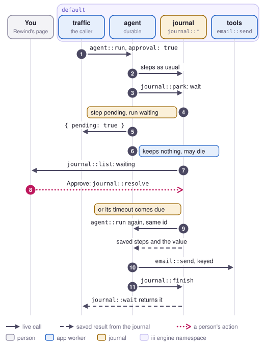

# Pause

Pause lets a durable run stop on purpose until something outside it happens: a person approves
an invite, a value arrives from another system, or a set time passes. While it waits, no worker
runs it and nothing is held open for it. The run starts again on whichever agent is up, with the
same workflow id, once its step is resolved. In this repo the agent pauses before each invite when
it is started with `approval: true`, and a person approves it from Rewind's page (job 6 in
[jobs.md](../jobs.md), which was written before the journal and doesn't name it).

<picture>
  <source media="(prefers-color-scheme: dark)" srcset="../media/flow-pause-dark.svg">
  
</picture>

## Steps

1. **The caller** starts the run. `traffic::burst` with `approval: true`, Rewind's shoot script or
   `iii call` calls `agent::run` with `{ request, approval: true, _workflow_id }`.
2. **The agent's preload** runs the steps as in [Resume](resume.md): `journal::begin`, then an
   intent and a result for each call. The agent reads the time, asks the model, finds a slot.
3. **The agent's code** reaches the invite and calls
   `worker.call({ function_id: 'durable::wait', payload: { name: 'approval', timeout_ms, detail, choices } })`.
   `detail` is `{ function_id: 'email::send', input }`, the invite about to go out, and `choices`
   are Approve and Decline. The preload takes the next step number for it, checks it against a
   saved step the way it checks any call, and sends `journal::park` instead of a call.
4. **The journal**, in one transaction, saves the step as pending with its name, its detail and
   choices, and its deadline, `now + timeout_ms`. The workflow's status becomes `waiting` with no
   owner, so the recovery sweep leaves it alone. If a value was already sent to `approval` for this
   workflow, the journal returns it here instead and nothing waits.
5. **The preload** marks the run stopped, so the wait throws `WAITING` and every later call in the
   handler throws too, whatever the code does with the error. The handler returns
   `{ pending: true, workflow_id, waiting_for }` to its caller, the shape iii's harness uses for a
   call whose result comes later. Returning rather than throwing keeps the queue from retrying a
   run that only parked. `traffic::burst` looks the run up with `journal::wait`, which returns as
   soon as the run waits, and counts it as waiting.
6. **Nothing runs.** The agent can die, restart or scale to zero. The journal can restart too:
   the pending step and its deadline are rows in `data/journal.sqlite`, and on start the journal
   sets a timer for the next one due.
7. **Rewind's page** lists the run under Waiting, from `journal::list` with `{ status: "waiting" }`.
   A person opens it, reads the invite, and clicks Approve. The page calls `journal::resolve` with
   `{ workflow_id, step, value: { approved: true } }`. A script or another system can resolve by
   name instead: `{ workflow_id, name: "approval", value }`.
8. **The journal**, in one transaction, saves `{ timed_out: false, value }` as the step's result,
   keeps the value under the wait's name, ends the pending and sets the workflow running with no
   owner. It returns `{ resolved: true, resumed: true }` and calls `agent::run` with the workflow's
   input and the same `_workflow_id`, the way recovery does. If the deadline comes first, the
   journal's timer does the same with `{ timed_out: true }`, and a late resolve gets
   `{ resolved: false, reason }`. So does a second resolve.
9. **The agent's preload** calls `journal::begin`, gets epoch 2 and the saved steps, and the code
   runs again from the top. Every finished step returns its saved result without a call, the wait
   included, so the code sees the approval and goes on to `email::send`, which gets its idempotency
   key as usual.
10. **The preload** calls `journal::finish`, and the caller waiting in `journal::wait` gets the
    workflow with its output. The page, which waited on `journal::wait` after the resolve, shows
    "Run booked" and the reply.

`durable::sleep` with `{ ms }` goes the same way, with a wake time for its deadline and
`{ slept_ms }` for its result. Resolving a sleep wakes it at once. A step a crash cut off is one
more pending step, of kind `lost`: [Resume](resume.md) has how it starts, and the page offers Send
again (`action: "execute"`) or Enter its result (`value`).

## What it guarantees and what it doesn't

Once the journal has saved a step as pending, the run continues exactly once after the step is
resolved, with the value that resolved it, as long as the journal and a worker hosting the function
come back. A value and a timeout racing for one wait can't both land: whichever transaction runs
first is the step's result, and the other gets `resolved: false`. A value sent before the run
reaches its wait is kept under the wait's name and used when the run gets there. While a run waits,
its worker keeps no memory, no running handler and no open call for it.

Some things it doesn't do:

- The run's caller gets `{ pending: true }`, not the run's output. The output is in the journal,
  where `journal::wait` returns it.
- The code before the wait runs again when the run resumes. Its calls return saved results, but
  requests around iii, such as the holiday fetch, run again.
- A wait's name gets one value per run. A second wait with the same name returns the same value.
- A sleep always parks, so even a short one costs a restart of the run and a replay of its steps.
- Nothing checks who resolves a step. Anyone who can call `journal::resolve` on the engine can.

## Limits

- Only Node workers with Rewind's preload can pause. Elsewhere, and outside a durable run, a call
  to `durable::wait` or `durable::sleep` fails at once with an error saying it only works inside a
  durable run: the preload throws `NOT_DURABLE` when there is no run, and the journal registers
  both functions to fail the same way for workers without the preload.
- Rewind records the execution that parked as a run that returned `{ pending: true }`. The preload
  handled the `durable::wait` and never sent it, so no recording has an answer for it, and a copy
  Rewind starts has no journal to ask. A replay, fork or check of the run pauses at the wait with
  reason `no_answer`, where a person can type its value, such as
  `{ "timed_out": false, "value": { "approved": true } }`.
- The page resolves one run at a time. A decision for every run waiting for approval at once is
  left out.
- A deadline fires on the journal's timer, within a few milliseconds when the journal is up. When
  the journal was down at the deadline, the run starts once the journal is back.

## Where it is in the code

- `workers/rewind/preload/node/durable.mjs`: `durable::wait` and `durable::sleep` as steps, the
  `WAITING` stop, and the `{ pending: true }` reply.
- `workers/journal/src/store.ts`: the `pending` and `wait_values` tables, `park`, `resolve` and
  `due`; `deadlines.ts`: the timer; `worker.ts`: `journal::park`, `journal::resolve` and the
  `durable::*` functions that fail outside a run; `recovery.ts`: starting a resolved run at once.
- `workers/agent/src/worker.ts`: the `approval` input and the wait before `email::send`.
- `workers/traffic/src/worker.ts`: counting waiting runs, and `approval: true` for a burst.
- `workers/rewind/ui/src/components/waitingRuns.tsx` and `waitingRun.tsx`: the page's Waiting
  levels; `src/model/pending.ts`: grouping and the lines a person reads.
- [durable-execution.md](../durable-execution.md#pausing-a-run): the decisions behind this and what
  the probes measured.
