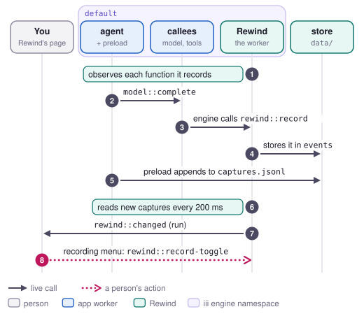

# Record

Rewind keeps every call between the app's functions, with its input, its answer and who made it,
so the other flows have something to replay. It runs whenever Rewind is up, for the developer and
for whoever is on call, and nobody has to start it. A person only touches it to stop or start
recording one function.

<picture>
  <source media="(prefers-color-scheme: dark)" srcset="../media/flow-record-dark.svg">
  
</picture>

## Steps

1. **Rewind** checks that it owns `rewind::record`, and exits if another worker does, because the
   observers would deliver to that worker instead. It then reads the function list with
   `engine::functions::list` and calls `observe` for each function on its record list, with
   `rewind::record` as the target. The record list is every function in `default` that declares
   `metadata.effects`, plus the entry function `agent::run`. Rewind's own functions and functions
   marked `internal` stay off it. The capture is `input`, `output`, `error`, `caller` and `metadata`, so a call
   that fails fires the observer as well as one that succeeds. Rewind reads the list again every
   10 seconds, and shortly after `engine::on-functions-changed` fires.
2. **The app** runs as it always does. A request reaches `agent::run` in `default`, and the agent
   calls `clock::now`, `model::complete`, `calendar::find-slot` and `email::send` on the live
   workers. Rewind is not in the path of any of these calls.
3. **The engine** calls `rewind::record` after each observed call has finished, with its input,
   its output or error, its timing, and the worker, function and invocation id of its caller.
4. **Rewind** skips any call that Rewind made itself, which covers every live call a fork, check or
   recovery makes, by its caller's worker name (`rewind` or `rewind-stubs`). It stamps the call
   with its trace id, and stamps a call of the entry function with the version of the agent's code
   on disk. Then it hands the call to a writer thread, which stores whatever has arrived, up to 500
   calls, in one transaction in the `events` table of `data/rewind.sqlite`. When 20,000 calls are
   already waiting, Rewind drops the call and adds one to `recorder.dropped`.
5. **The agent's preload** appends one JSON line to `data/captures.jsonl` for each request that goes
   around iii, such as the holiday `fetch`, for each request the worker's own HTTP server receives,
   and for each call of a traced function. Each line says which iii invocation it ran in. The
   Python preload in the tools worker does the same for `http.client` and `httpx` requests, such as
   the POST inside `email::send`.
6. **Rewind** reads new lines from the capture file every 200 ms. It stores each request in
   `events` under the call it ran in, and each function span in `data/spans.sqlite`.
7. **Rewind** calls `rewind::changed` with `{ kind: "run", id }` once no call for the run has
   arrived for 300 ms, and never later than 2 seconds after the run arrived, because in-process
   calls are reported in batches after their parent. When a dead worker cut the run short, a
   `lost` event goes out with it. The page observes `rewind::changed` and adds the run to its
   lists.
8. **A person** can turn recording off or on for one function from the recording menu, which calls
   `rewind::record-toggle`. Rewind saves the setting, which wins over the declared effects, and
   starts or stops observing that function straight away.

Rewind also observes `engine::on-workers-changed` and stores each worker that connects or
disconnects in `default`. A run's page shows those changes from the run's start to 5 seconds after
it ended, which is how a run shows the tools worker stopping in the middle of it.

## What it guarantees and what it doesn't

The app never waits for Rewind. Observers fire after the caller already has its answer, and
`rewind::record` hands each call to the writer thread and returns. When the writer falls 20,000
calls behind, Rewind drops calls instead of making the engine wait, and the recording menu shows a
dot with the count.

A run's calls come back in the order they started, which is not the order they arrived in. A
recorded error keeps its code and message. Credentials in request headers never
reach the capture file: `Authorization`, `Cookie`, `Set-Cookie` and any header whose name contains
`token`, `secret`, `password` or `api-key` are kept with `[redacted]` as the value. A body over
64 KiB keeps its first bytes and a SHA-256 of the whole body.

Rewind does not record everything that happened:

- A call made while Rewind is down or cut off from the engine is lost, because the engine drops its
  event. Requests around iii are kept, because the preloads write them to disk.
- On iii 0.26 the engine never reports a call cut off by its own worker dying. Rewind still sees
  the run, and finds the cut-off call from the calls that came after it.
- The engine never reports a call whose caller died before it returned, even though the callee
  finished it. So when the agent dies during `agent::run`, Rewind never gets a root event for that
  execution and never lists it.
- A function that doesn't declare effects isn't recorded until a person turns it on.

## Limits

- Only functions in `default` are recorded.
- The Python preload does not capture requests that arrive at a Python worker's own HTTP server.
- Function spans are kept for the newest 200 runs.
- Every 10 minutes Rewind drops calls that started more than `REWIND_KEEP_DAYS` ago (7 by
  default), or before the newest `REWIND_KEEP_RUNS` runs of the entry function (20,000 by
  default). The same pass drops the worker changes from before then and the forks of runs that
  are gone.
- A function whose host sets an `onObservationDeliver` hook reaches Rewind only if that host passes
  its calls on (`docs/spike-0.26.md`).

## Where it is in the code

- `workers/rewind/src/recording.rs`: the record list, the observers, `rewind::record` and the
  writer thread.
- `workers/rewind/src/store.rs`: the `events` table and the queries the other flows read.
- `workers/rewind/src/captures.rs`: reading `data/captures.jsonl` and moving it aside once it is
  long.
- `workers/rewind/src/settling.rs`: when a run's `run` and `lost` events go out.
- `workers/rewind/src/changes.rs`: `rewind::changed`.
- `workers/rewind/src/workers.rs`: workers connecting and disconnecting.
- `workers/rewind/src/retention.rs`: dropping old calls and forks.
- `workers/rewind/preload/node/` (`fetch.mjs`, `inbound.mjs`, `spans.mjs`, `capture.mjs`,
  `headers.mjs`) and `workers/rewind/preload/python/`: the preloads.
- `workers/rewind/ui/src/components/recordingMenu.tsx`: the recording menu.
