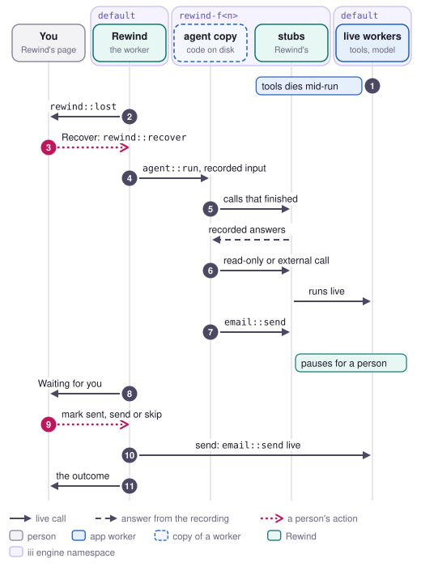

# Recover

Recover finishes runs that a worker's death cut short, without sending anything twice by accident.
It is for whoever is on call after an incident, when a callee's worker, such as the tools, died in
the middle of a burst and the agent's runs failed with `invocation_stopped` or `function_not_found`
(job 6 in [jobs.md](../jobs.md)). Rewind runs each interrupted run again as a copy of the agent in a
namespace of its own, where stubs return the recorded answers, and a person approves every call
that writes or can't be undone before Rewind sends it.

<picture>
  <source media="(prefers-color-scheme: dark)" srcset="../media/flow-recover-dark.svg">
  
</picture>

## Steps

1. **A worker dies** in the middle of a run, for example the tools worker killed with
   `npm run kill-tools`. The engine fails the calls it was running with `invocation_stopped` and
   never reports them to observers. Calls made in the second before compose restarts it fail with
   `function_not_found`. The agent catches tool errors and hands them to the model, so its run
   usually ends with `status: "failed"`, and Rewind records it like any other run.
2. **Rewind** counts a run as interrupted when `invocation_stopped` appears in its error, its output
   or the input of any of its calls, or when `function_not_found` appears there for a function
   Rewind has seen. It sends a `lost` event on `rewind::changed` with the run. `rewind::lost` scans
   the newest 2,000 runs of `agent::run` and returns each interrupted one with `lost_at`, the place
   the cut-off call would have had, and `mid_call`, which is true when that call failed with
   `invocation_stopped` and may have reached its provider. The page lists these runs under
   Interrupted, grouped by the worker that stopped and when.
3. **A person** clicks Recover all on a group, or Recover on one run. The page calls
   `rewind::recover` with `{ run_id }` for each run, up to four at a time. When the run already has
   a recovery, Rewind returns that one as it is. Otherwise it starts a fork in recover mode, with
   `auto` off and no stops, and sets up its namespace and copy the same way as steps 2 and 3 of a
   [replay](replay.md).
4. **Rewind** calls `agent::run` in `rewind-f<n>` with the run's recorded input.
5. **The stubs** return the recorded answer for each call that finished before the interruption.
6. **The stubs** run a later call live in `default` without asking when every effect it declares is
   `pure`, `read-only` or `external`, which covers `calendar::find-slot`, `model::complete` and GET
   and HEAD requests. The call that was cut off mid-call, and any call a copy makes inside it, runs
   again on its own only when it is pure or read-only, because running it twice changes nothing.
7. **The stubs** pause the recovery at the first call they may not run on their own:
   - the call cut off mid-call, when it does more than read, pauses with reason `lost`, because
     nobody can tell whether it reached its provider before the worker died;
   - any other call that writes, is irreversible or declares no effects pauses with reason
     `no_answer`. That includes a send the recovery reaches after the interruption, and a call that
     failed with `function_not_found`, which never reached a worker.

   The stub fails the copy's call with `REWIND_PAUSED`, the copy's run ends, and Rewind stores the
   recovery as paused, with the call's input, its effects, the choices it allows and its response
   format.
8. **The page** shows the paused recoveries under Waiting for you, in one group per kind of pause
   and function. Interrupted mid-send lists the pauses with reason `lost`, where the provider may
   have the send. Not sent yet lists the rest.
9. **A person** decides once for a group, or one run at a time, and the page sends the decision to
   each run with `rewind::answer`, up to four runs at a time:
   - Mark all sent picks `typed`, with the result the same function returned in a recorded run,
     which the page looks up. It is the preset for Interrupted mid-send.
   - Resend all, for interrupted sends, and Send all, for sends that never went out, pick `live`.
     Resend all asks first and says how many could be duplicates.
   - Skip all picks `stop`, which deletes the recovery and sends nothing.
   - Choose per run opens each run, where the decision panel offers every choice the pause allows:
     Send now (`live`), Already sent (`typed`), Inject error (`inject`) and Skip run (`stop`).
     In a recovery, `live` is on offer for every call, because only a person can settle the calls a
     recovery pauses at.
10. **Rewind** acts on the choice and runs the recovery again from the start. A `live` choice
    calls the function in `default` from Rewind, with a 30 second timeout, before the rerun begins.
    In the rerun the call gets the chosen answer, and the calls after it go through steps 5 to 7.
11. **Rewind** stores the recovery and calls `rewind::changed`. The page moves the run to Recovered
    and says how the group ended, such as "3/3 marked sent · 3 booked". A run that fails doesn't
    stop the others, and the page lists it with a retry at the end.

## How it waits for a person

A recovery waits as a stored fork, and nothing waits on a timeout. The copy's run ends within
milliseconds of the pause, and the recovery stays paused until someone answers it, across page
reloads and Rewind restarts. Its copy keeps running for 300 seconds after the last rerun, so an
answer in that time reruns in milliseconds. A later answer starts the copy cold.

The person answers on the page, with a group decision or from the run's decision panel. Another
caller can send `rewind::answer` with `{ fork_id, choice, value }` itself, or call
`rewind::fork-set` with `auto: true`. With `auto` on, a recovery fills a call that writes, is
irreversible or declares nothing with another run's answer instead of pausing. The call cut off
mid-call still pauses as `lost` unless it only reads.

## What it guarantees and what it doesn't

A recovery never sends a call that writes, is irreversible or declares no effects unless a person
chooses to send it. A call that may have reached its provider pauses as `lost` unless it only
reads, with `auto` on or off. Recovering a run twice returns the same recovery, so Recover all on a
group that is partly recovered leaves the finished ones alone.

Sending is up to the person:

- Resend on an interrupted send can deliver it twice. Rewind sends the call without an idempotency
  key, so `email::send` can't drop the repeat the way it does for a durable run.
- If Rewind dies after a live send and before the rerun's result is stored, the stored recovery
  still waits at that call, and answering it again sends it again.
- Mark sent gives the run another run's reply, such as a different message id, without asking the
  provider whether the send arrived.
- Pure, read-only and external calls run live, so the model can take the recovered run down another
  path than the one the interrupted run was on.

## Limits

- Recover can't see a run whose own worker died. When the agent dies, the engine never reports the
  interrupted `agent::run`, so Rewind never gets a root for it and `rewind::lost` never lists it.
  [Resume](resume.md) covers that case for durable functions.
- `rewind::lost` looks only at runs of the entry function, and only at the newest 2,000.
- A `function_not_found` for a function Rewind has never seen, such as a tool name the model made
  up, doesn't make a run interrupted.
- Rewind finds the cut-off call by searching the run's later calls for the two error codes. When a
  call's input quotes `invocation_stopped` anywhere, Rewind counts that call as cut off mid-call, so
  a person decides whenever it is unclear.
- Rewind copies the worker that owns `agent::run` according to the current function list, so the
  agent has to be connected.
- The page recovers four runs at a time, because each one starts its own copy and sends its live
  calls to workers that compose may have restarted moments before. Rewind keeps four spare copies
  to match.
- The page never passes `auto` or `stops` to `rewind::recover`.

## Where it is in the code

- `workers/rewind/src/recovery.rs`: `rewind::lost` and `rewind::recover`.
- `workers/rewind/src/runs/lost.rs`: `lost_call` and `lost_mid_call_at`, which find the cut-off
  call and decide whether it was cut off mid-call.
- `workers/rewind/src/replay/decision.rs`: `lost_call`, the `runs_live` row for recover mode, and
  `choices`, which offers `live` for every call in a recovery.
- `workers/rewind/src/forks/mod.rs`: `start`, `answer` and `stop`.
- `workers/rewind/ui/src/components/lostWork.tsx`: Recover all and the group decisions;
  `recoveryView.tsx`: one run's recovery; `waitingGroup.tsx` and `model/waiting.ts`: the groups and
  what each decision sends; `model/batch.ts`: four runs at a time; `model/lost.ts`: grouping
  interrupted runs by the worker that stopped.
