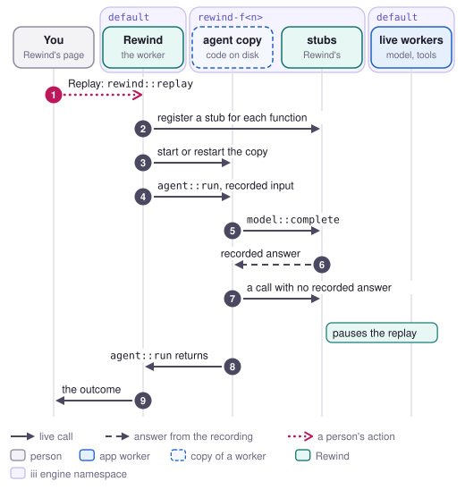

# Replay

Replay runs a recorded request again against the worker's code on disk, and every call the code
makes gets the answer it got the first time. The developer reaches for it when a request failed
because of an answer that won't come back, such as a model's output, and they want to watch it fail
the same way on their machine (jobs 1 and 2 in [jobs.md](../jobs.md)).

<picture>
  <source media="(prefers-color-scheme: dark)" srcset="../media/flow-replay-dark.svg">
  
</picture>

## Steps

1. **A person** opens a run and clicks Replay, which reads "Replay with current code" when the
   agent's code has changed since the recording. The page calls `rewind::replay` with
   `{ run_id, auto_read }`, and `auto_read` stays off unless the person turned it on. Opening a run
   from a check result starts a replay the same way.
2. **Rewind** reads the run and its calls from the store and picks a namespace for the copy. When
   the run's root function belongs to the worker under test, the agent, Rewind takes the oldest
   spare `rewind-f<n>` from its pool, which already has its stubs registered and a copy running.
   Otherwise it takes the next fork number and opens `rewind-f<n>` cold. On a connection of its own
   in that namespace, Rewind registers a handler for every function in `default` that the copy
   doesn't run itself, plus `rewind::outside` for requests around iii. It waits until
   `engine::functions::list` shows all of them in the namespace. Nothing falls back to `default`,
   so a call to a function without a handler fails with `function_not_found`.
3. **Rewind** makes sure the copy runs the code on disk. It hashes the agent's folder, and when no
   copy runs, or the copy started on older code, it stops the old copy and starts the worker's start
   command as a child process with `III_NAMESPACE=rewind-f<n>`, `III_URL` and
   `REWIND_CAPTURE=replay`. Then it waits until the copy's functions show up in the namespace.
4. **Rewind** calls `agent::run` in `rewind-f<n>` with the run's recorded input and a 120 second
   timeout. It makes the call with a caller token of its own, so it can tell which invocation in the
   copy is the run.
5. **The copy** runs the agent's code. Each call it makes, such as `model::complete`, resolves in
   `rewind-f<n>`, where Rewind's handler acts as its stub. Each request around iii goes from the
   copy's preload to `rewind::outside` instead of the network.
6. **The stub** places the call by its position among its caller's calls. When the recording has a
   call at that place with the same function and the same input, the stub returns that call's
   recorded answer. Inputs are compared as canonical JSON without `_caller_worker_id`, and a request
   matches on its method, URL and body. A recorded error comes back with the message the caller saw.
   When the recording shows the caller gave up on a call, because the same call started again before
   the first finished, the stub waits as long as the recorded call took, so the copy's own timeout
   fires the way it did (bug 3).
7. **The stub** pauses the replay at a call the recording doesn't have. It keeps the call as the
   fork's pending call with reason `no_answer` and fails it with `REWIND_PAUSED`. Every later stub
   call fails the same way, so the copy's run ends within milliseconds. With `auto_read` on, a pure
   or read-only call runs live in `default` instead, and the stub returns the live answer.
8. **The copy's `agent::run`** returns or throws.
9. **Rewind** stores the result as a fork with `edit_at: null` and mode `debug`. Its outcome is
   `paused` with the pending call, `done` with the output, or `crashed` with the error. Rewind stops
   the copy in the background, or keeps it running for the next answer when the replay paused, and
   calls `rewind::changed` with `{ kind: "fork" }`. The page shows "Reproduced" with the outcome
   when every call got its recorded answer, or "Replay diverged at call n" when it paused.

The same function replays runs whose root isn't `agent::run`:

- A run of `calendar::find-slot` someone made with `iii call` replays in a cold copy of the tools
  worker, the worker that owns the root.
- With `copy: ["tools"]`, a replay of an agent run also starts a copy of the tools worker in
  `rewind-f<n>-tools`. A call to `email::send` then runs the tools' Python in that copy, and the POST
  inside it goes to `rewind::outside`, where it gets the recorded response. The page doesn't offer
  this, so it is for callers of `rewind::replay`.
- A request that arrived at a worker's own HTTP server replays in `rewind-h<n>`. Rewind starts a copy
  of the worker that received it, sends the recorded request to the address the copy's preload
  prints, and ends with the response. Nothing in that replay runs live.

## What it guarantees and what it doesn't

A replay doesn't change the live system. With `auto_read` off it doesn't call anything in
`default`, and with it on it runs only calls that declare `pure` or `read-only`, plus GET and HEAD
requests. That rests on each function declaring its effects correctly. Rewind
leaves the calls it makes itself out of the recording, so a replay never adds runs. Each replay runs
the code that is on disk when it starts, and the fork says which version in `code`.

When the code depends only on its input and on what its calls return, a replay ends the same way
every time, because every call gets the same answer, the same error and the same timing of a
timeout. Code that reads the clock, draws a random number, or reads the environment or a file
outside a call can take another path. The agent reads the time from `clock::now` and every choice
from `model::complete` for that reason.

Matching goes by position and input. A code change that adds, removes or reorders a call, or sends
a different input, misses the recording from that call on, and the replay pauses there.

## Limits

- Rewind can't replay a resumed durable run as one run. It records each execution as a run of its
  own, and an execution after the first recorded only the calls the journal didn't answer. Its
  replay starts the agent from the top without a journal, so it pauses, or calls live with
  `auto_read`, where the journal's saved results belong.
- A copy inherits Rewind's environment, not the worker's. If compose sets `HOLIDAYS_URL` on the
  agent or `EMAIL_URL` on the tools, it has to set the same values on Rewind, or every replayed
  request misses the recording.
- The calls a callee makes inside itself replay only when the fork copies that callee's worker.
  Otherwise the stub returns the callee's recorded answer and its inner requests never happen.
- An inbound replay takes only GET and HEAD requests and refuses the rest with
  `REWIND_NOT_REPLAYABLE`. A request whose body the preload cut at 64 KiB is refused too.
- Only the worker under test has spare copies. A replay of a run rooted in another worker, and each
  extra copied worker, waits a few seconds for a cold start.
- A paused replay keeps its copy for 300 seconds after its last rerun
  (`REWIND_PAUSED_IDLE_SECS`), and at most 8 paused forks keep their copies at once
  (`REWIND_PAUSED_OPEN`). After that, answering it starts the copy cold.
- The page always replays with `auto` off and no stops. `auto`, `stops` and `copy` exist on
  `rewind::replay` for other callers.

## Where it is in the code

- `workers/rewind/src/functions.rs`: `rewind::replay`.
- `workers/rewind/src/forks/mod.rs`: `replay`, `start` and `run`, which make and run the fork.
- `workers/rewind/src/copies/spares.rs`: taking a spare; `copies/space.rs`: the handlers and the
  copies in a namespace; `copies/process.rs`: one copy as a child process; `copies/spaces.rs`:
  keeping a paused fork's copy and closing idle ones.
- `workers/rewind/src/replay/stubs.rs`: `run_in` and the stub handlers;
  `replay/session.rs`: where each call is placed; `replay/decision.rs`: `decide`.
- `workers/rewind/src/runs/steps.rs` and `runs/inference.rs`: the recording as the steps a replay
  matches, with what the caller saw of each call.
- `workers/rewind/src/inbound.rs`: replaying a request to a worker's own server.
- `workers/rewind/src/outside/`: matching and sending requests around iii.
- `workers/rewind/ui/src/components/runWorkspace.tsx` and `forkSwitcher.tsx`: the Replay button and
  its result.
