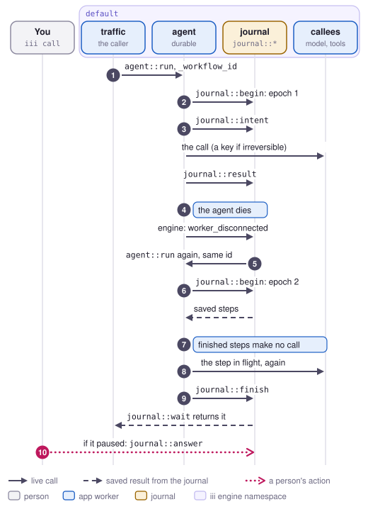

# Resume

Resume finishes a durable run on the live workers after the worker running it died. When the agent
dies in the middle of `agent::run`, the journal starts the run again on the agent that compose
brings back, with the same workflow id, and every step that already finished gets its saved result
instead of being called again. It happens without anyone starting it, and the on-call person steps
in only when a step that was in flight can't be repeated safely (job 6 in [jobs.md](../jobs.md),
which was written before the journal and doesn't name it). Such a step waits for the person as a
pending step, the same way a run that stops on purpose waits for a value, which [Pause](pause.md)
covers.

<picture>
  <source media="(prefers-color-scheme: dark)" srcset="../media/flow-resume-dark.svg">
  
</picture>

## Steps

1. **The caller** starts the run. `traffic::burst` calls `agent::run` with `_workflow_id` in the
   input, such as `burst-1a2b3c4d-7`. The id goes in the input because the queue path drops
   metadata. A function opts in to all of this with `durable: true` in its metadata, and in this
   repo `agent::run` is the only one.
2. **The agent's preload** wraps the handler, and before the agent's code runs it calls
   `journal::begin` with the workflow id, the function, the input without `_workflow_id` and
   `_caller_worker_id`, and a hash of that input. The journal creates the workflow at epoch 1,
   records the agent's worker id as its owner, and returns no saved steps. A run that arrives
   without `_workflow_id` gets `wf-<invocation id>`.
3. **The preload** turns each call the code makes into a step, numbered in the order the code starts
   them. Before the call goes out, `journal::intent` saves the epoch, the step number, the function
   and the input hash. When the callee declares `irreversible`, the journal also returns an
   idempotency key, `<workflow id>:<step>`, and the preload puts it in the call's metadata. After
   the call returns, `journal::result` saves its value or error, and only then does the code see
   it. Calls to `journal::*` and requests around iii, such as the holiday fetch, are not steps.
4. **The agent dies.** The engine fails the in-flight `agent::run` with `invocation_stopped`, so the
   caller gets that error, and it fires `worker_disconnected`. The journal observes
   `engine::on-workers-changed` and clears the owner of every running workflow that worker had.
5. **The journal's recovery** sweeps right after the disconnect and then every second. For each
   running workflow with no owner, an owner that is gone, or no write for 5 minutes
   (`JOURNAL_STALE_MS`), it waits until `agent::run` is listed in `default` again and calls it with
   the workflow's input and the same `_workflow_id`. A workflow the queue started is left to the
   queue for 30 seconds after its last write, since the queue delivers the job again on its own.
   Meanwhile the caller that got `invocation_stopped` waits for the outcome with `journal::wait`.
6. **The preload** in the restarted agent calls `journal::begin` again. The journal refuses it as
   `DIVERGED` if the function or input hash don't match the workflow. Otherwise it gives the run
   epoch 2 and the restarted agent as its owner, and returns the saved steps. If the step that was
   in flight needs a person, it becomes a pending step and the workflow waits here, before any of
   the code runs again.
7. **The agent's code** runs again from the top. Each step with a saved result returns it without a
   call, as long as its function and input hash match. A mismatch stops the run as `DIVERGED`, and
   the journal marks the workflow failed.
8. **The preload** sends the step that was in flight again, because the journal has its intent and
   no result. The journal decided how from the callee's declared effects. A step whose effects are
   all `pure`, `read-only` or `external` goes out again. An `irreversible` step whose function
   declares `idempotency_key: true` goes out again with its original key, and `email::send` drops a
   send whose key it has already seen. In this app those two rules cover every callee.
9. **The preload** calls `journal::finish` when the code returns or throws. The journal marks the
   workflow done or failed and wakes everyone waiting in `journal::wait`, who get the workflow with
   its output.
10. **A person** resolves a step left pending at step 6, from Rewind's page or with
    `journal::resolve`, and the journal starts the run again at once. The next section has the
    details.

If the old handler is still running, because only its connection dropped, its next write to the
journal still says epoch 1. The journal refuses it as `FENCED` and keeps a record of it, and the
preload makes every later call in that handler throw the same error, so the old execution can't go
on.

## How it waits for a person

A step in flight at the crash that is irreversible without `idempotency_key: true`, writes, or
declares no effects can't be sent again safely, so the journal leaves it pending, the same way it
leaves a `durable::wait` pending ([Pause](pause.md)). It does this in `journal::begin` at step 6:
the step's status becomes `pending` with kind `lost`, and the workflow's status becomes `waiting`
with no owner. `agent::run` returns `{ pending: true, workflow_id, waiting_for }` without running
any of its code. The journal logs it, `journal::wait` returns the workflow with status `waiting`
and its pending step, and `traffic::burst` counts it as waiting. The sweep leaves a waiting
workflow alone, and calling `agent::run` again with the same id returns the same reply.

Rewind's page lists the run under Waiting, as "Cut off mid-call · billing::charge", and offers
Send again and Enter its result, with neither picked. Without the page, a person finds waiting
workflows with `journal::list` and `{ status: "waiting" }` and resolves one with `iii call`:

- `{ workflow_id, step, action: "execute" }` sends the step again, with its key if it has one.
- `{ workflow_id, step, value }`, or `{ workflow_id, step, error }`, takes that as the step's
  result and sends nothing.

```bash
iii call --engine ws://127.0.0.1:49334 journal::resolve --json '{"workflow_id":"burst-1a2b3c4d-7","step":4,"action":"execute"}'
```

Either way the workflow becomes `running` with no owner, the journal calls `agent::run` again at
once, and the run goes on from step 6. A second resolve returns `resolved: false`. In this app
every callee is either repeatable or keyed, so a crash never leaves a step pending this way, and
the journal's unit tests cover it. `journal::resolve` took the place of `journal::answer`, which
only those tests called.

## What it guarantees and what it doesn't

Once `journal::begin` has returned, the run ends exactly once, with the outcome its own code
reaches, as long as the journal and a worker hosting the function come back. A step whose result
the journal saved is never sent again. The step in flight is sent again only when a repeat is
harmless or goes out with the same idempotency key, and otherwise the run waits for a person. A handler
from an older epoch can't save anything once a newer execution has taken over. The code sees a
result only after the journal has committed it.

Some things still happen twice or not at all:

- The caller of the interrupted call still gets `invocation_stopped`. The outcome is in the
  journal, where `journal::wait` returns it.
- A model call in flight at the crash is made twice, because the engine dropped the model's answer
  along with the dead caller.
- The agent's own retry of a slow send (bug 3) still sends two invites, because the journal sees
  two steps.
- A run whose call never reached the agent, because the agent was down when it was sent, has no
  journal yet. The caller has to send it again with the same workflow id, or send it through the
  queue.
- Requests around iii run again on every execution.
- When the journal refuses a write, or stays unreachable for 30 seconds (`REWIND_JOURNAL_WAIT_MS`),
  the run stops. The sweep starts it again 5 minutes after its last write.

## Limits

- Rewind can't replay a resumed run yet. It records each execution as a run of its own, and an
  execution after the first records only the calls it made live. Rewind never gets a root event
  for the execution that died. The journal's `executions` table lists every execution.
- Only Node workers with Rewind's preload can run durable functions, so a Python or Rust function
  can't be durable. Their functions can still be steps, because the caller's preload makes them.
- A copy that Rewind starts runs with `REWIND_CAPTURE=replay` and never keeps a journal, so a
  replay, fork or recovery of a durable run runs without one. `REWIND_DURABLE=off` turns the
  journal off for a live worker too.
- A durable function's code may depend only on its input and on what its calls return. Changing
  the code while runs are in flight fails those runs as `DIVERGED`.
- The journal reads each callee's effects from the function list when it writes the step's intent.
  A callee the engine didn't list at that moment counts as declaring nothing, and is left pending
  for a person if it was in flight.
- The journal is one SQLite file, `data/journal.sqlite`, in one process, and nothing replicates
  it.
- Resume doesn't help when a callee's worker dies. The callee's `invocation_stopped` is saved as the
  step's result, the agent's code handles it as it always does, and the run finishes. That run
  shows up in Rewind under Interrupted, where [Recover](recover.md) applies.

## Where it is in the code

- `workers/rewind/preload/node/durable.mjs`: the wrapper, step numbering, the calls to
  `journal::begin`, `journal::intent`, `journal::result` and `journal::finish`, and stopping a
  fenced handler.
- `workers/rewind/preload/node/sdkHooks.mjs`: the loader hook that wraps what `registerWorker`
  returns; `index.mjs`: loading it only in record mode.
- `workers/journal/src/worker.ts`: the `journal::*` functions; `store.ts`: workflows, steps,
  epochs, fencing and pending steps; `resume.ts`: sending a step again, with its key, or leaving
  it for a person; `recovery.ts`: the sweep, `journal::on-workers-changed`, and starting a run
  whose pending step was resolved; `callees.ts`: each callee's effects.
- `workers/rewind/ui/src/components/waitingRun.tsx`: the page's Send again and Enter its result.
- `workers/agent/src/worker.ts`: `durable: true` on `agent::run`.
- `workers/tools/src/main.py`: `email::send` keeping the keys it has seen.
- `workers/traffic/src/worker.ts`: workflow ids, waiting in `journal::wait`, and the queue path.
- [durable-execution.md](../durable-execution.md): the decisions behind this and what the bursts
  measured.
