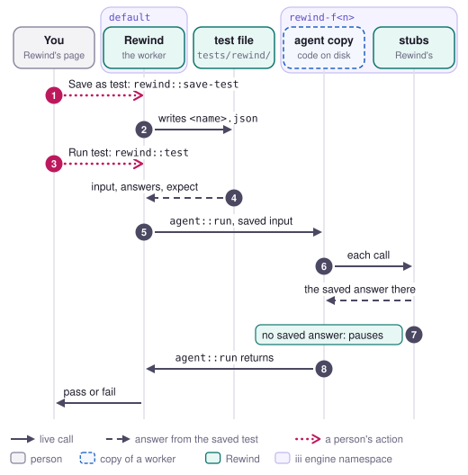

# Save as test

Save as test writes one finished fork to a JSON file, with the run's input, the answer every call
got and how the run ended. Running the test later replays the code on disk against those answers
alone and says whether it still ends the same way. The developer reaches for it once a fix works,
to keep the failing run as a test (job 5 in [jobs.md](../jobs.md)).

<picture>
  <source media="(prefers-color-scheme: dark)" srcset="../media/flow-save-as-test-dark.svg">
  
</picture>

## Steps

1. **A person** opens a fork or a replay that finished, either done or crashed, and clicks Save as
   test. The page suggests a name made from the failure's signature and the run's short id. It
   calls `rewind::save-test` with `{ fork_id, name }`.
2. **Rewind** builds the test from the fork's latest rerun and writes it to
   `tests/rewind/<name>.json`. It lowercases the name and turns anything other than a letter, a
   digit, `-` or `_` into `-`. Without a name, the file is named after the first 8 characters of
   the run id and the fork id, such as `run-3f2a9c10-f7.json`. The file has four fields:
   - `entry`, the run's root function, such as `agent::run`;
   - `input`, the run's recorded input;
   - `answers`, one for each call the rerun made, with its `seq`, its `path` when it is a call
     inside another call, its `function_id`, the `input` it sent without the engine's
     `_caller_worker_id`, its `answer`, its `source`, and a `hold` when the caller gave up on that
     call;
   - `expect`, which is `{ status }` when the output has a `status`, `{ output }` when it doesn't,
     or `{ throws }` with the error message.

   A paused fork is refused with `REWIND_FORK_PAUSED`. Rewind returns the path from the project
   folder along with the test.
3. **A person** clicks Run test, and the page calls `rewind::test` with `{ path }`. Or someone runs
   `npm run saved-tests` with the stack up, which calls `rewind::test` for every file in
   `tests/rewind` one after another, prints each result with what diverged, and exits with 1 when
   any test fails. A test's name, a path from the project folder and an absolute path all work, as
   long as the file is inside `tests/rewind`. A path that leads anywhere else, with `..` or through
   a link, is refused with `REWIND_BAD_INPUT`.
4. **Rewind** reads the file and turns each saved answer into an answer at its place. A file whose
   answers have no `input`, saved before tests compared inputs, is refused with
   `REWIND_BAD_FIXTURE` until someone saves it again or adds `"match": "function"` to each of
   those answers.
5. **Rewind** takes a namespace `rewind-f<n>`, a spare when the entry runs in the worker under test,
   registers the stubs, and makes sure a copy of the entry's worker runs the code on disk. Then it
   calls the entry there with the saved input.
6. **The stub** for each call returns the saved answer at that place when it is for the same
   function and the call sends the saved input. Inputs are compared the way a replay compares one
   with the recording: as canonical JSON without `_caller_worker_id`, and on method, URL and body
   for a request around iii. An answer with `"match": "function"` in the file skips the input, for
   a call whose input changes on every run. When the answer has a `hold`, the stub first waits as
   long as the recorded call took, so the copy's timeout fires the way it did.
7. **The stub** pauses at any call the file has no answer for, and at a call whose input differs
   from the saved one. Nothing in a test runs live.
8. **The copy's entry** returns, throws or ends at the pause. Rewind closes the namespace and its
   copy and returns `{ pass, expected, outcome, diverged }`. A test passes when the run is done with
   the expected `status`, or exactly the expected `output`, or when it crashed with the expected
   error message. A paused run fails as diverged. `diverged` says where: the call's `seq`,
   `function_id` and `input`, what the file has at that place under `saved`, and under
   `differences` each field of the input that changed, as a JSON pointer with the `saved` value
   and the one the call `sent`. A call the file has no answer for has no `saved`. Rewind doesn't
   store a test run as a fork.
9. **The page** puts Passed or Failed beside the test's path. A test that diverged says at which
   call, such as "Diverged at call 2 · model::complete", and for a call that sent another input, it
   lists each field with what the test saved and what the code sent.

## What it guarantees and what it doesn't

Running a test doesn't call anything in `default` or send anything. A saved test has every answer
it needs, so it still runs after Rewind has dropped the recorded run. It runs the code that is on disk
when it starts, so it tells whether a later change still gets the same ending from the same
answers.

A test checks the ending and what each call on the way there sends. It compares the status, the
whole output or the error message. A change that sends a different input to a call, or adds or
reorders a call, reaches a call the file has no answer for, pauses there, and fails as diverged.
An answer marked `"match": "function"` is the exception: its call gets the saved answer whatever
it sends. Answers that came from live calls or from another run in the fork are frozen in the file
as they were in that rerun.

## Limits

- Saved tests are committed with the code. `.gitignore` leaves out only the test the end-to-end
  check saves each time it runs, `tests/rewind/e2e-*.json`. Running one needs the stack: the
  engine, Rewind and a copy of the agent. So `npm run saved-tests` runs against a stack someone
  started with `iii compose --up`, and the repo has no CI job that runs it.
- A test copies only the entry's worker. A call that ran in another worker's copy in the fork gets
  the copy's answer back from a stub, and the calls inside it don't happen.
- A call whose input changes on every run, such as one that quotes the copy's own invocation id,
  diverges every time the test runs. Rewind can't tell that apart from a change in the code, so a
  person marks that answer `"match": "function"` in the file.
- Only a fork can be saved. To save the original run as it was recorded, replay it and save the
  replay. The page offers Save as test on forks and replays that ended, and never on the original.

## Where it is in the code

- `workers/rewind/src/fixtures.rs`: `save`, `run`, `fixture_of`, `expect_for`, `passes`,
  `diverged`, the file name and the check that a path stays inside `tests/rewind`.
- `workers/rewind/src/functions.rs`: `rewind::save-test` and `rewind::test`.
- `scripts/savedTests.ts`: `npm run saved-tests`.
- `workers/rewind/src/replay/decision.rs`: `decide`, where a saved answer comes first, and
  `OwnInputs`, which makes a test's answers match on input as well as place and function.
- `workers/rewind/ui/src/components/saveTest.tsx`: Save as test, Run test and what a test that
  diverged shows; `model/savedTests.ts`: the call and the fields it shows; `runWorkspace.tsx`:
  saving and running; `compareView.tsx` and `forkSwitcher.tsx`: where the buttons appear.
